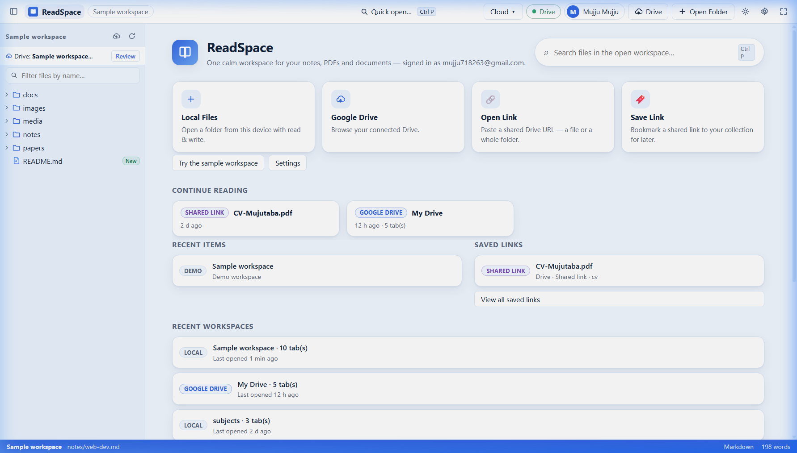
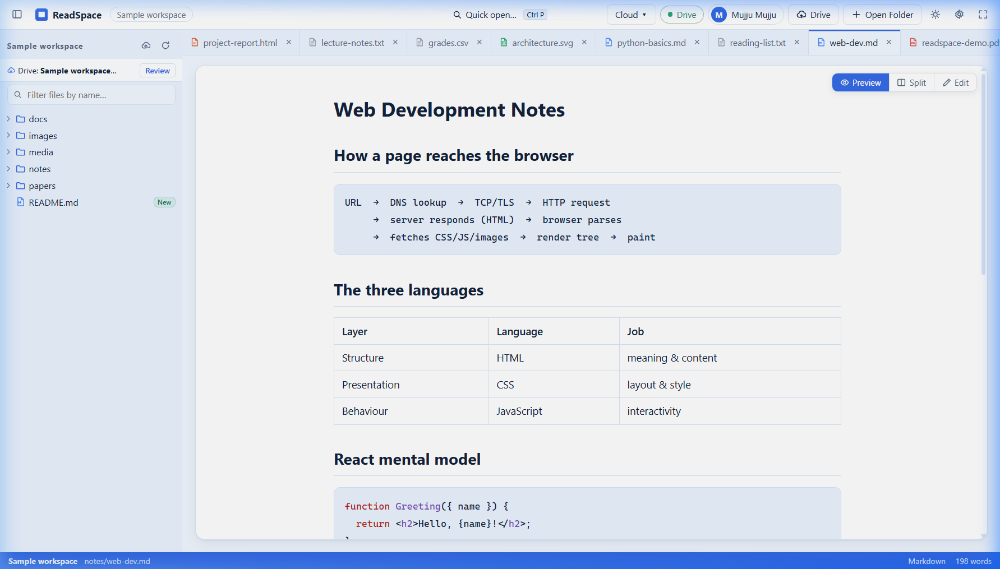
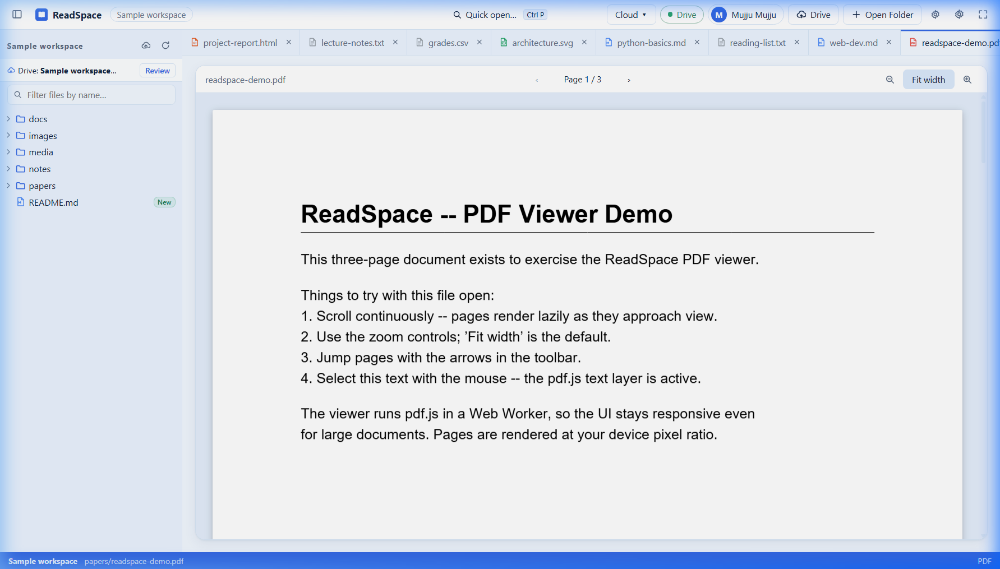
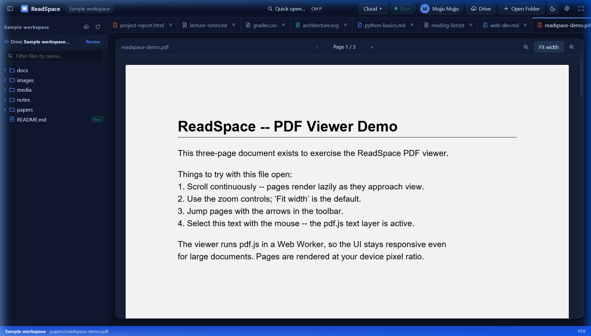
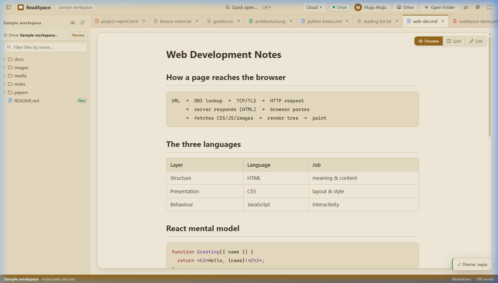
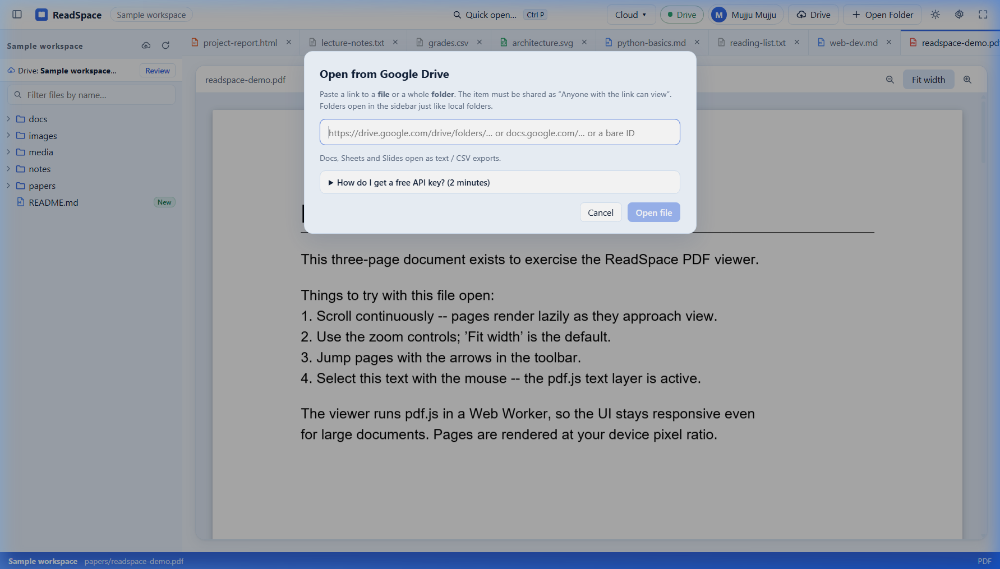

# ReadSpace 📖✨

<div align="center">


<br/>

**A modern, distraction-free document & workspace reader for your notes, PDFs, and presentations — entirely in the browser. Features dual-pane reading, Google Drive cloud workspaces, multi-tab navigation, and local-first persistence.**

[Features](#-key-features) • [UI Showcase](#-ui-showcase) • [Architecture](#-architecture--design) • [Quick Start](#-quick-start) • [Environment Config](#-setup--configuration-env) • [Mobile App](https://github.com/mujju-212/readspaceapp)

</div>

---

## 📸 UI Showcase

<table>
  <tr>
    <td width="50%" align="center">
      <b>🏠 Home Dashboard (Ice Blue)</b><br/><br/>
      
      <br/><sub>Quick Actions, Continue Reading, Recent Workspaces & Activity</sub>
    </td>
    <td width="50%" align="center">
      <b>📝 Multi-Tab Reader Workbench</b><br/><br/>
      
      <br/><sub>Multi-tab bar, tree explorer, Markdown preview with syntax highlighting</sub>
    </td>
  </tr>
  <tr>
    <td width="50%" align="center">
      <b>📄 PDF.js Continuous Reader</b><br/><br/>
      
      <br/><sub>High-resolution canvas rendering, zoom controls, fit width & page jump</sub>
    </td>
    <td width="50%" align="center">
      <b>🌙 Dark Theme Reader Mode</b><br/><br/>
      
      <br/><sub>Sleek low-light reading with contrast-tuned code blocks</sub>
    </td>
  </tr>
  <tr>
    <td width="50%" align="center">
      <b>📜 Sepia Warm Paper Theme</b><br/><br/>
      
      <br/><sub>Calm eye-comfort paper palette for long reading sessions</sub>
    </td>
    <td width="50%" align="center">
      <b>☁️ Google Drive Cloud Link & Connect</b><br/><br/>
      
      <br/><sub>OAuth 2.0 PKCE cloud file picker and shared link bookmarking</sub>
    </td>
  </tr>
</table>

---

## 🏗️ Architecture & Design

<div align="center">


<br/>
<sub>ReadSpace system architecture — web client, local file system drivers, Node.js server, Google Drive proxy, and storage</sub>

<br/><br/>


<br/>
<sub>Google Drive OAuth 2.0 PKCE authentication flow and server-side token encryption</sub>

</div>

---

## 🌟 Key Features

### 1. 🗂️ First-Class Workspaces
- **File System Access API**: Open local folders directly in Chrome/Edge with persistent read/write permissions.
- **Graceful Fallbacks**: Safari and Firefox support via read-only `webkitdirectory` snapshotting.
- **Sample Workspace**: Explore a pre-seeded multi-format library with zero configuration.
- **Collapsible File Explorer**: Directory tree with file kind badges, search filter, and instant file switching.

### 2. 📖 Universal Multi-Format Reading Engine
- **Markdown**: GitHub-Flavored Markdown preview, auto-generated headings, tables, task lists, and syntax-highlighted code.
- **PDF Documents**: Powered by `pdf.js` in a dedicated Web Worker with continuous lazy scroll, page jumping, text selection, and fit-width zoom.
- **Office Files (DOCX & PPTX)**: Native browser rendering via `mammoth` and custom slide canvas viewers.
- **Sandboxed HTML**: Executed inside an `<iframe sandbox>` with strict script control and sanitization.
- **Media**: Integrated audio player with waveform equalizer and video player with scrubbers.
- **Editing Modes**: Toggle between **Preview**, **Split**, and **Edit** modes powered by CodeMirror 6 with `Ctrl+S` disk save.

### 3. ☁️ Google Drive Cloud Sync (v1.1)
- **Identity & Drive Separation**: Sign in with Google (identity only) or explicitly authorize Google Drive access.
- **1000-Item Batching**: High-performance directory fetching loading complete folders in a single round-trip.
- **Conflict-Aware Writes**: Guarded by `ifModifiedTime` checks — prevents silent overwrites by offering overwrite, copy, or reload options.
- **Saved Links**: Bookmark shared Google Drive links with `resourceKey` preservation without duplicating files on the server.
- **Server-Side Token Security**: OAuth refresh tokens are encrypted at rest with **AES-256-GCM** on the server.

### 4. 🎨 Ice Blue Aesthetics & Personalization
- 5 Handcrafted Themes: **Ice Blue (Default)**, **Light**, **Dark**, **Sepia**, and **System/Auto**.
- Reading Customization: Adjust reader font family, size, line-height, and content margin width.
- Layout Control: Draggable sidebar divider with double-click reset, zen mode (`Ctrl+Alt+Z`), and independent content scrolling.

### 5. 📱 Companion Mobile App
Looking for the mobile experience? Check out the native companion app:
👉 **[ReadSpace Mobile Repository (React Native & Expo SDK 52)](https://github.com/mujju-212/readspaceapp)**

---

## 🚀 Quick Start

### 1. Install Dependencies
```bash
git clone https://github.com/mujju-212/readspace.git
cd readspace
npm install
```

### 2. Run Development Server
```bash
npm run dev
# Vite HMR server runs at http://localhost:5173
```

### 3. Production Build & Full Server
```bash
npm run build
npm run serve
# Production server runs at http://localhost:5173 (Static UI + /api routes)
```

The server starts in **sandbox mode** by default, allowing you to test mock Google authentication and Drive workspaces immediately without credentials.

---

## ⚙️ Setup & Configuration (`.env`)

To connect real Google Drive accounts and MongoDB, create a `.env` file in the root directory:

```bash
cp .env.example .env
```

Generate an AES-256 encryption key for refresh tokens:
```bash
node -e "console.log(require('crypto').randomBytes(32).toString('hex'))"
```

### Environment Variables Matrix

| Variable | Description | Required? |
| :--- | :--- | :--- |
| `GOOGLE_CLIENT_ID` | OAuth 2.0 Client ID from Google Cloud Console | For real Google Drive |
| `GOOGLE_CLIENT_SECRET` | OAuth 2.0 Client Secret (used strictly server-side) | For real Google Drive |
| `TOKEN_ENCRYPTION_KEY` | 64-char hex key for AES-256-GCM token encryption | Recommended |
| `APP_BASE_URL` | Public base URL (e.g. `http://localhost:5173`) | Dev / Production |
| `GOOGLE_REDIRECT_URI` | OAuth callback URI (default: `${APP_BASE_URL}/api/auth/google/callback`) | Optional |
| `MONGODB_URI` | MongoDB / Atlas connection string (falls back to local JSON db) | Optional |
| `PORT` | Server listening port (default: `5173`) | Optional |

---

## 📁 Repository Layout

```
readspace/
├── api/                    # Serverless API routes entry
├── docs/                   # Architecture, auth, and flow diagrams
│   ├── diagrams/           # HTML diagram sources
│   └── images/             # Rendered PNG architectural diagrams
├── prd/                    # Product requirement & technical design docs
├── public/                 # Static assets & sample workspace files
├── screenshots/            # High-resolution application screenshots
├── scripts/                # Smoke tests, diagram renderers & utility scripts
├── server/                 # Express backend service
│   ├── index.mjs           # Server bootstrap & static hosting
│   └── lib/                # OAuth, AES-256 crypto, sessions & Drive proxy
├── src/                    # React 18 TypeScript frontend
│   ├── components/         # TitleBar, Explorer, TabBar, Viewers & Modals
│   ├── features/           # Cloud sync, transfers, and saved links
│   ├── services/           # File System Access drivers, persistence & API client
│   ├── stores/             # Zustand state management stores
│   ├── styles.css          # Ice Blue design system & responsive layout
│   └── App.tsx             # Workbench shell and layout manager
├── package.json            # Project dependencies and npm scripts
├── tsconfig.json           # TypeScript configuration
└── vite.config.ts          # Vite build and development configuration
```

---

## 🧪 Testing & Verification

Run the automated smoke test suite to verify file reading and API endpoints:

```bash
# Verify UI components and rendering
node scripts/ui-smoke.mjs

# Verify cloud sync and Google Drive endpoints
node scripts/cloud-smoke.mjs

# Run complete browser smoke test
node scripts/smoke.mjs
```

---

## 📄 License

Distributed under the MIT License. See `LICENSE` for details.

---

<div align="center">
  <sub>Built with ❤️ using React 18, TypeScript, and Vite. Designed for calm, distraction-free reading.</sub>
</div>
