# ReadSpace 📖

**A VS Code–style reader workspace for your notes and documents — entirely in the browser.**

Open a folder (or paste a **Google Drive link**), browse it in the Explorer sidebar, and read any file in its own tab: **Markdown, PDF, DOCX, HTML, TXT, CSV and images** — with a Preview / Edit toggle for text formats and a fully customizable, resizable layout.

As of **v1.1** there's an optional account: sign in with Google (identity only), **connect Drive with OAuth**, and your Drive becomes a first-class workspace — browse it, edit files back to the cloud, upload/scan/download with an explicit review step, and get your tabs & scroll positions restored on any device. Metadata lives server-side in MongoDB-shaped collections (swap in Atlas via one env var); your documents stay in Drive.

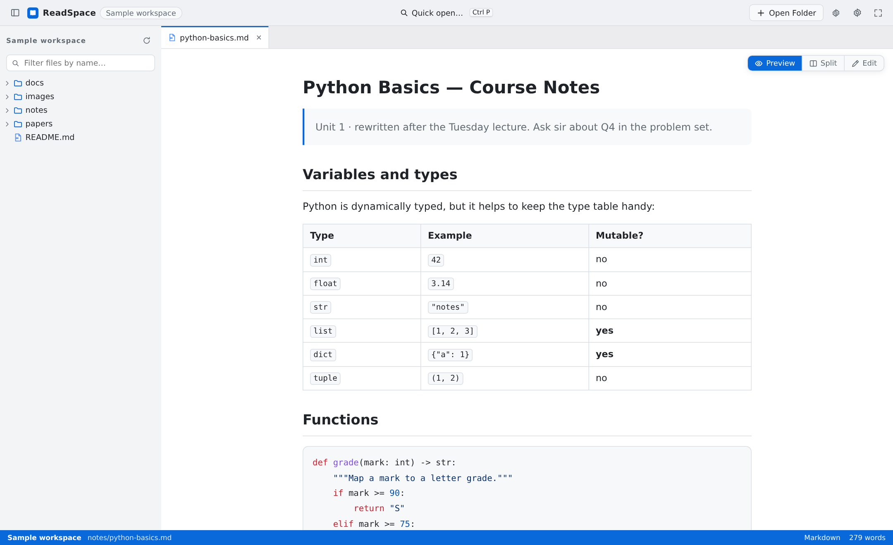
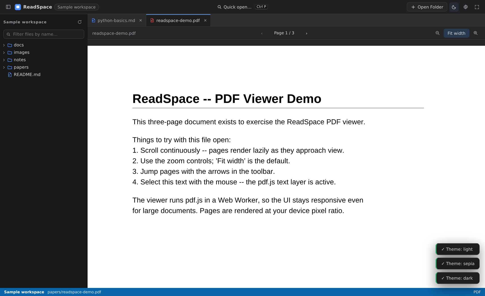
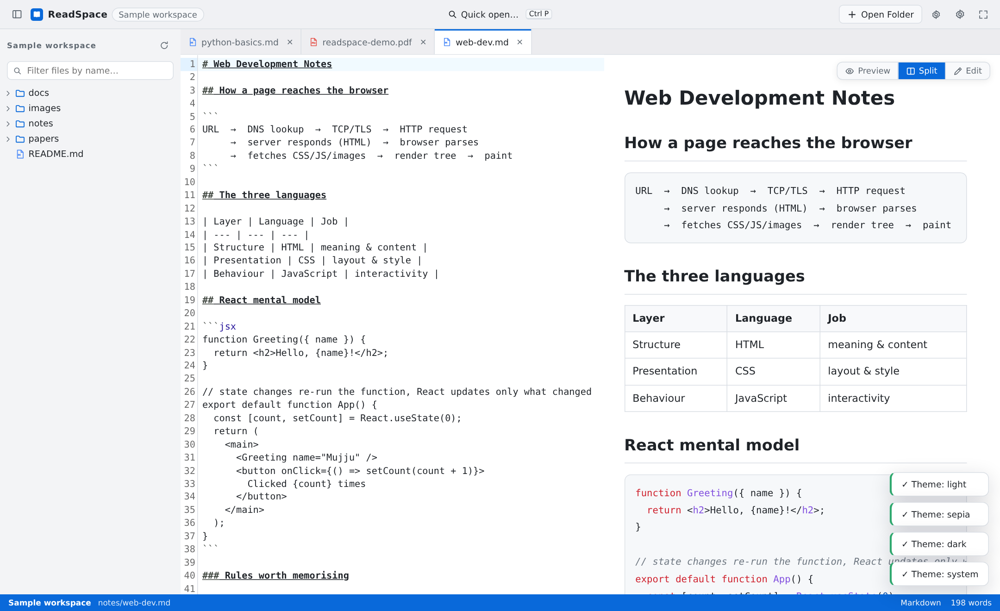
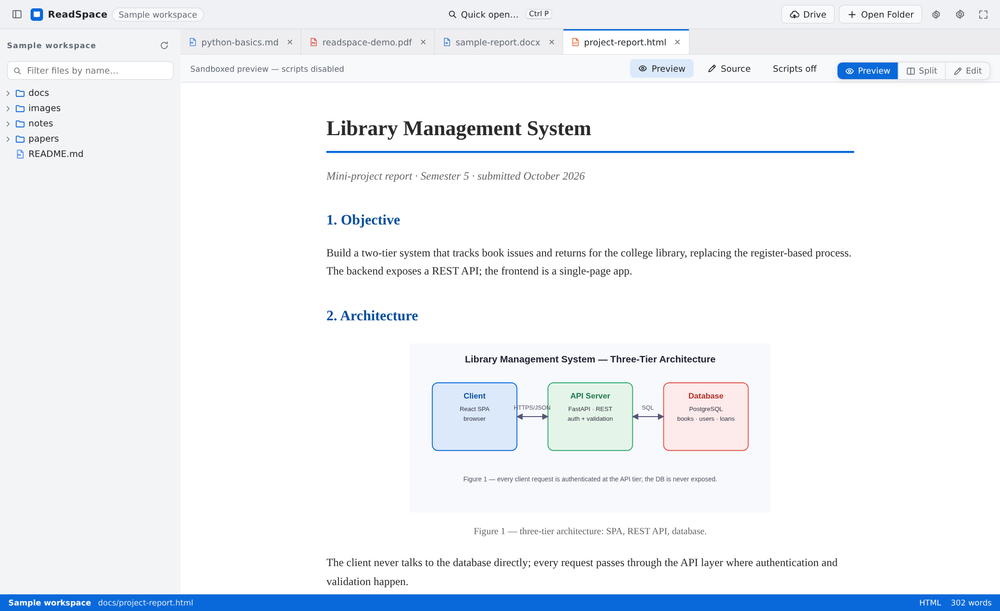
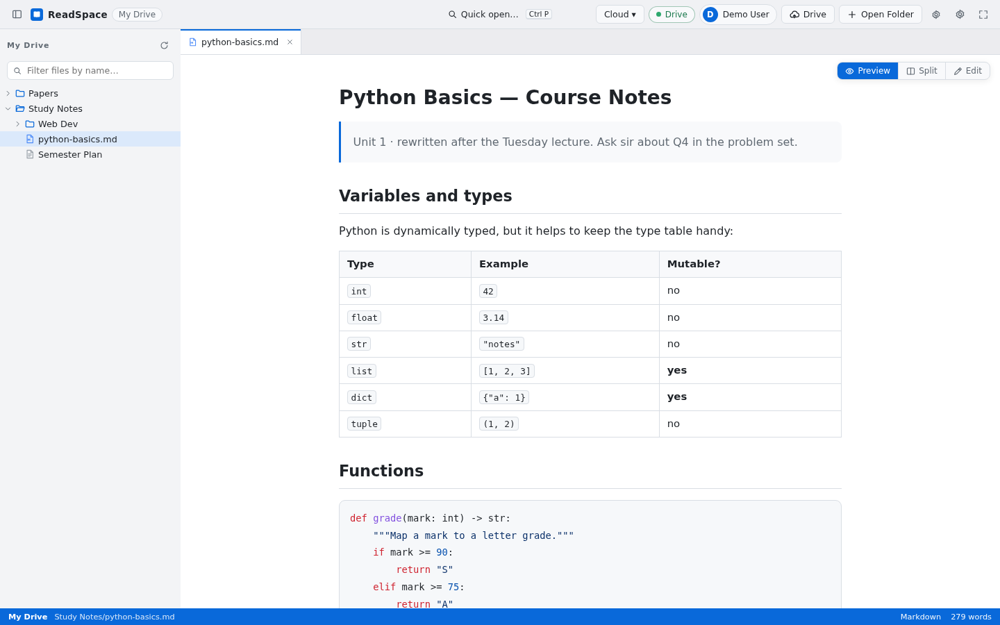
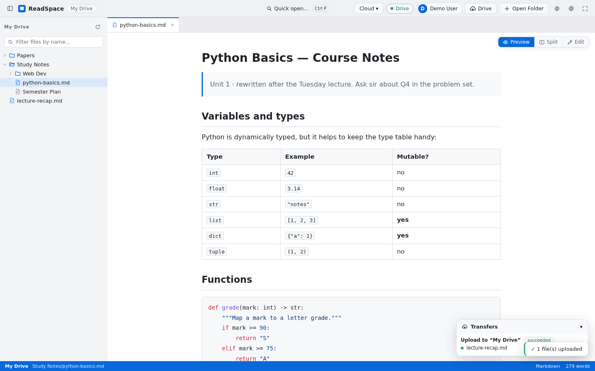
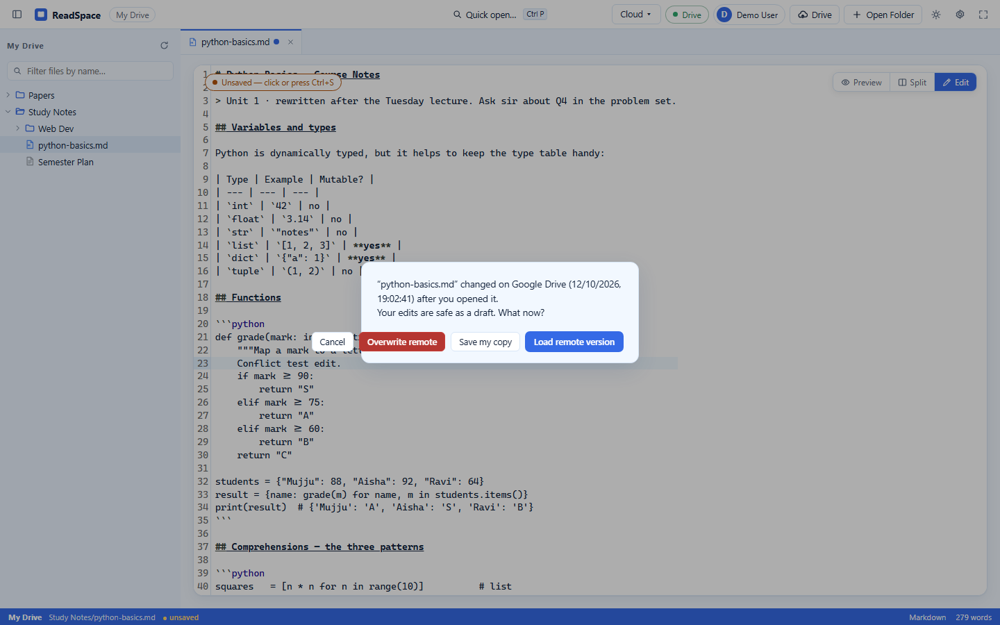
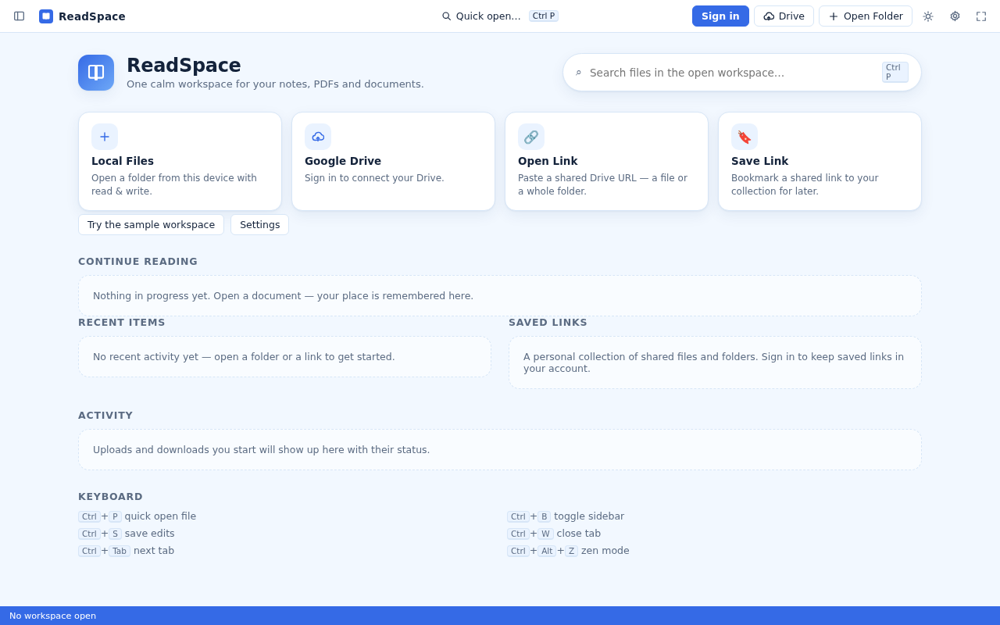
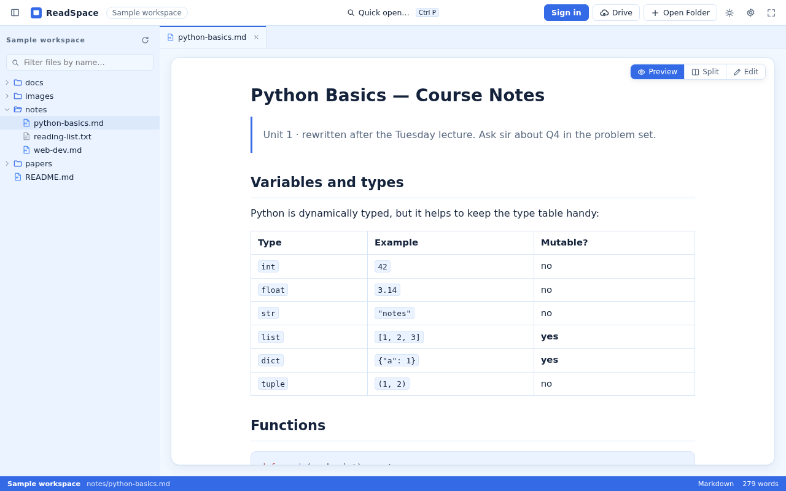
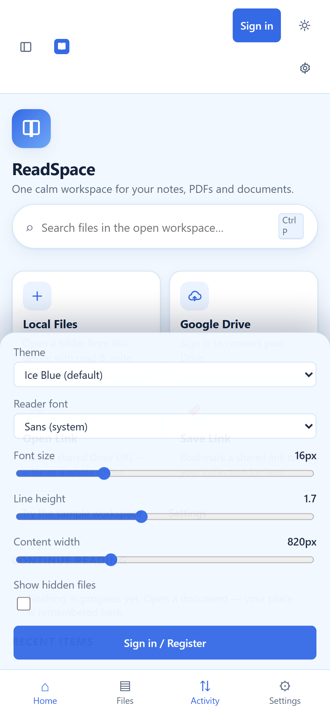

### How it fits together

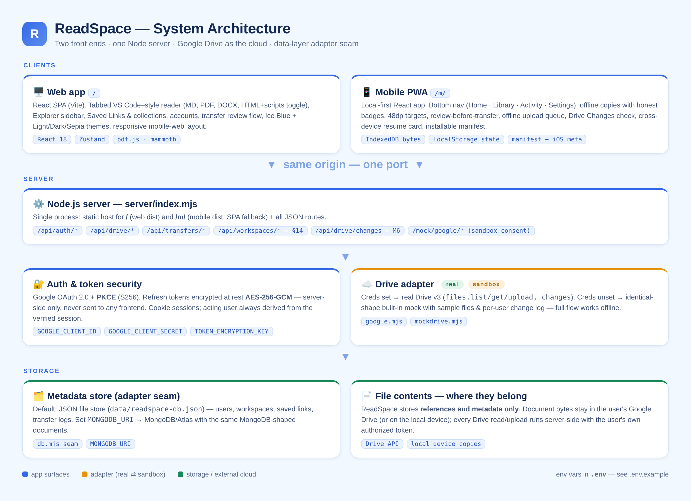
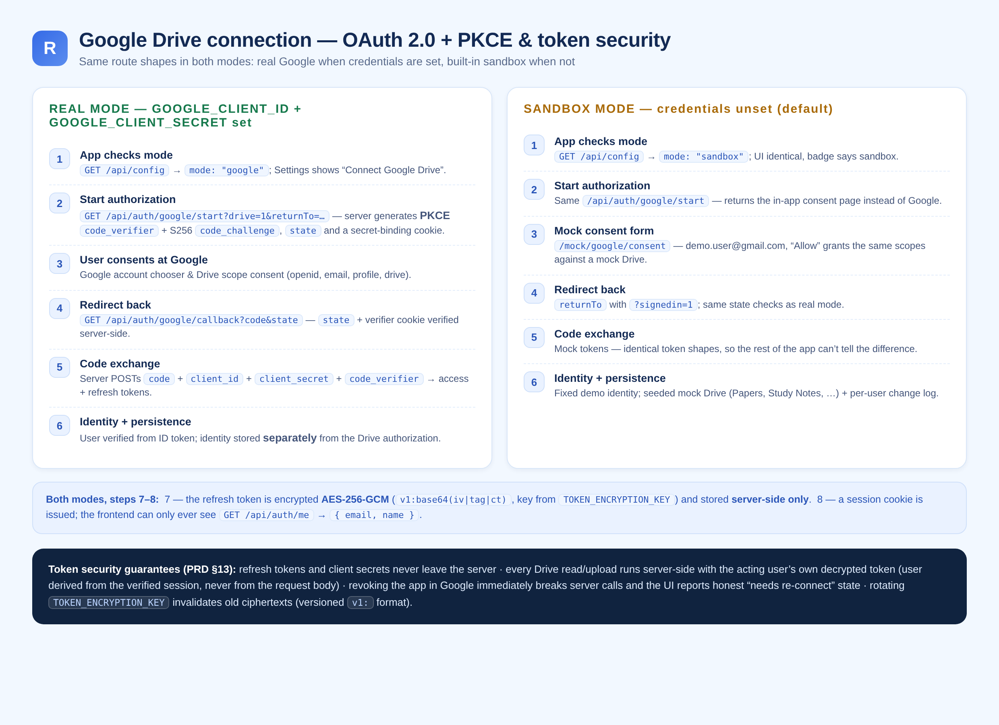

*(Diagrams live in [`docs/images/`](docs/images) — sources in [`docs/diagrams/`](docs/diagrams), re-render with `node scripts/render-diagrams.mjs`.)*

---

## Features

| Area | What you get |
| --- | --- |
| **Workspace** | Open Folder via the File System Access API (Chrome/Edge, read *and write*), read-only folder snapshot on Firefox/Safari, **Google Drive file/folder links**, or the built-in sample workspace |
| **Google Drive (v0.2)** | Paste any Drive link — file, folder, Docs/Sheets/Slides — and browse it like a local folder (lazy tree, Drive API v3 + your own free API key, items must be “anyone with the link”) |
| **Account & sign-in (v1.1)** | Google sign-in (identity) is separate from Drive authorization (OAuth code + PKCE, offline access). Sign in from the title-bar chip; disconnect Drive or sign out any time |
| **Drive workspace (v1.1)** | Your Drive as a workspace: lazy tree, open/edit/save cloud files, native-doc export (Docs→TXT, Sheets→CSV, Slides→TXT), cloud saves guarded by `ifModifiedTime` conflict detection |
| **Transfers (v1.1)** | Upload selected files, **scan a local folder for new/changed files** → review → confirm (classifies `likely_new` / `same_candidate` / `name_collision`; never silently overwrites), download files/folders (native export choices, collision-safe naming), cancellable transfer panel |
| **Session sync (v1.1)** | Reading sessions tied to your account: tab order, active tab, scroll positions and layout follow you across devices; device session still wins locally |
| **Saved links (v1.1)** | A personal collection of *references* to shared Drive files/folders, grouped into user-defined collections (College, Projects, Books…). Preserves the link's `resourceKey`; opening respects the owner's sharing — if they revoke, the record stays and the app says access is gone |
| **Explorer** | Lazy, collapsible file tree, type-colored file icons, filter-by-name, refresh, hidden-file toggle |
| **Tabs** | **Every opened file gets its own persistent tab** (no preview-replacement), drag to reorder, middle-click to close, right-click to close others, unsaved-changes dot |
| **Viewers** | GFM Markdown (tables, task lists, syntax-highlighted code, workspace-relative images), pdf.js PDF (continuous scroll, fit-width/zoom, page nav, text selection), DOCX via mammoth, sandboxed HTML with a per-file “allow scripts” toggle, text with wrap toggle, image viewer |
| **Edit** | Preview / Split / Edit toggle (top-right, per your sketch) with CodeMirror 6, Ctrl+S saves back to disk, crash-recoverable drafts |
| **Layout** | Draggable sidebar divider (double-click resets), collapsible sidebar, independent content scroll, zen mode |
| **Customization** | **Ice Blue (default)**, Light, Dark, Sepia, System/Auto themes; reader font family, font size, line height, content width |
| **Persistence** | Restores last folder (local or Drive), tabs, active tab and tree expansion after restart; recents on the welcome screen; unsaved-draft recovery |
| **Productivity** | Quick open (Ctrl+P) with fuzzy matching, status bar (type · word count · dirty state) |
| **Home dashboard (v1.3)** | Quick actions (Local Files · Google Drive · Open Link · Save Link), **Continue Reading** with progress, **Recent Items** (activity-driven) kept separate from **Saved Links** (user-curated), Recent Workspaces, Activity, Keyboard |
| **Mobile app (v1.0, M5–M6 incl.)** | **`mobile/`** — a dedicated offline-first mobile app served at **`/m/`** (React + TS, Android-first/iOS-ready per the mobile PRD): no-login local reading, recents + position restore, full-screen reader (PDF page nav · MD/TXT/HTML/DOCX · find · bookmarks · text settings), Library with Local/Drive segments, upload destination → review → confirm, offline copies with badges, Activity with per-file results, **queued transfers that auto-run on reconnect (background scope), Drive Changes API check, cross-device session resume (MOB-12), PWA install + iOS meta**, Ice Blue default theme |
| **Responsive web (v1.3)** | One responsive app: desktop (persistent sidebar, 4-in-a-row quick actions, two-column lists), tablet (compact columns), **mobile browser** (bottom nav Home/Files/Activity/Settings, explorer as a drawer with scrim, 2×2 quick-action grid, 44px touch targets, bottom-sheet dialogs, sticky compact top bar, no horizontal overflow) |

## Run it

```bash
npm install
npm run dev        # vite dev server (HMR) on :5173
```

Production build + static server:

```bash
npm run build
npm run serve      # full server on :5173 — UI + /api + sandbox Google (sign-in & Drive work out of the box)
```

The bundled server runs in **sandbox mode**: a mock Google sign-in and a seeded mock Drive, so every v1.1 flow is clickable with zero setup. To point it at real Google (and MongoDB), see the next section.

## Setup & configuration (`.env`)

All server configuration lives in a repo-root **`.env`** file — copy the committed example and fill in what you need:

```bash
cp .env.example .env
node -e "console.log(require('crypto').randomBytes(32).toString('hex'))"   # → TOKEN_ENCRYPTION_KEY
```

`.env` is auto-loaded by the server on start (simple `KEY=VALUE` lines, `#` comments), is **git-ignored**, and real environment variables always win over file values. This is where the Google **client id and secret key** live:

| Variable | What it does | Required? |
| --- | --- | --- |
| `GOOGLE_CLIENT_ID` | OAuth 2.0 **Client ID** from Google Cloud Console. Set together with the secret → the server talks to **real Google**; leave both empty → built-in **sandbox** mode | for real Drive |
| `GOOGLE_CLIENT_SECRET` | OAuth 2.0 **Client secret** — used only server-side for the code exchange (PKCE + offline access); never sent to any frontend | for real Drive |
| `TOKEN_ENCRYPTION_KEY` | Key material for **AES-256-GCM encryption of refresh tokens at rest**. Generate with the one-liner above. Loud dev-fallback warning if unset — **required before any real deployment** | production |
| `APP_BASE_URL` | Public base URL (e.g. `https://readspace.example.com`), used to build the OAuth redirect. Empty → derived from the incoming request (dev) | recommended |
| `GOOGLE_REDIRECT_URI` | Optional explicit override; defaults to `${APP_BASE_URL}/api/auth/google/callback` and must match Google Cloud Console exactly | rarely |
| `MONGODB_URI` | MongoDB / Atlas connection string for the metadata store. Unset → zero-setup JSON file store (`data/readspace-db.json`) with the same MongoDB-shaped documents | optional |
| `PORT` | Server port (default `5173`) | optional |

### Getting a Google client id + secret (≈2 minutes)

1. [Google Cloud Console](https://console.cloud.google.com/) → create (or pick) a project.
2. **APIs & Services → Library** → enable **Google Drive API**.
3. **APIs & Services → OAuth consent screen** → configure (scopes: `openid`, `email`, `profile`, `https://www.googleapis.com/auth/drive`).
4. **APIs & Services → Credentials → Create credentials → OAuth client ID** → type **Web application** → add Authorized redirect URI: `https://YOUR-HOST/api/auth/google/callback` (locally: `http://localhost:5173/api/auth/google/callback`).
5. Copy the **Client ID** and **Client secret** into `.env` as `GOOGLE_CLIENT_ID` / `GOOGLE_CLIENT_SECRET`, then restart the server. `/api/config` now reports `mode: "google"`.

The full flow (both modes, step by step, including how refresh tokens are encrypted and where they live) is the auth diagram above. `.env` is already in `.gitignore` — never commit it.

## Verify it (real-browser smoke test)

```bash
npx playwright install chromium
npx playwright install-deps chromium   # linux system libraries
npm run smoke                          # 26 end-to-end checks (local/sample/Drive-link features)
node scripts/mobile-smoke.mjs          # 46 mobile-app checks (at /m/): offline reading, position
                                       #   restore, Drive browse, offline copies, upload review, themes,
                                       #   queued transfers auto-resume, Drive Changes, cross-device resume
node scripts/ui-smoke.mjs              # 34 v1.3 checks: Ice Blue default, Home dashboard,
                                       #   desktop + mobile viewports, theme switching/persistence
node scripts/cloud-smoke.mjs           # 25 v1.1 checks: sign-in → OAuth consent → Drive edit &
                                       #   conflict → session restore → upload/scan/download → disconnect
```
(Start `node server/index.mjs` first for the cloud suite.)

## Try it in 10 seconds

1. Click **Try the sample workspace** on the welcome screen.
2. Expand `notes/` and click `python-basics.md` — tables, code highlighting, task lists. Every file you open adds a new tab.
3. Press `Ctrl+P`, type `demo.pdf`, Enter — the pdf.js viewer opens.
4. Press `Ctrl+P`, type `sample-report.docx` — Word rendering via mammoth.
5. Open `project-report.html` — sandboxed preview, relative image resolved.
6. Toggle **Edit** (top-right), type something, watch the dirty dot, `Ctrl+S`.
7. Drag the sidebar divider. `Ctrl+B` to collapse. `Ctrl+Alt+Z` for zen.
8. Reload the page — folder, tabs and layout come back.

## Opening from Google Drive

Click **Drive** (title bar or welcome screen) and paste a link — the item must be shared as *“Anyone with the link can view”*.

- **Google Docs / Sheets / Slides links open with no key at all** — Google's export endpoints are public.
- **Folders and uploaded files** (PDF, DOCX…) need a free Google API key. That's Google's rule, not ReadSpace's: listing a folder or downloading a binary is a Drive *API* call, and Google only allows signed API calls — “anyone with the link” applies to their website, not to apps. The dialog explains this and links each step (create project → enable Drive API → create key, ~2 minutes). The key is stored only in your browser.

Drive content opens in the sidebar exactly like a local folder — lazy-loading subfolders as you expand them — and is restored on your next visit.

## Sign in & your Google Drive (v1.1)

1. **Sign in** — the title-bar chip (or welcome screen) → demo sign-in in sandbox mode, or *Continue with Google* against real Google. Signing in is **identity only**: it never touches your files.
2. **Connect Drive** — a separate, explicit OAuth consent (scope `drive`, code + PKCE, offline access). The refresh token is encrypted with AES-256-GCM **on the server** and never sent to the browser.
3. **Open My Drive** — your Drive appears in the Explorer like any folder. Open files, edit, `Ctrl+S`: if the file changed remotely since you loaded it, ReadSpace shows a conflict dialog — **overwrite remote / save a copy / reload remote**. No silent overwrites, ever.
4. **Transfers** — the *Cloud* menu has upload (picked files), **scan local folder** (compares against Drive and queues a review table before anything is written), and download (native Google formats are exported — Docs→TXT, Sheets→CSV, Slides→TXT; name collisions get ` (1)`-style suffixes, never clobbered).
5. **Session restore** — open tabs, active tab, scroll positions and layout are synced to your account (debounced) and restored on any device.
6. **Saved links** — a classmate shares a PDF link; paste it in the Drive dialog and choose **Save link** (or **Save to collection…**). ReadSpace stores a record in your account: title, original URL, Drive file/folder id, resource type, the link's `resourceKey`, date added, your collection, plus reading progress and last-opened time. Opening later is one click — no digging through chat history. A saved link is a *reference, not a copy*: nothing is duplicated, and if the owner revokes access the link stays but reports it can no longer open.

The server keeps only **metadata** (users, connections, workspaces, sessions, folder mappings, transfer jobs) in MongoDB-shaped collections — file contents always live in Drive or on your device. The acting user is always derived from the signed session cookie, never from the client.

## Using your own folder

Click **Open Folder**. Chrome/Edge will ask for read-write access to the folder; ReadSpace remembers the grant (IndexedDB) and reconnects automatically next visit. Firefox/Safari get a read-only snapshot via `webkitdirectory`, and edits fall back to downloading a copy.

## Project layout

```
src/
├─ app shell ............ App.tsx (workbench grid, divider, shortcuts)
├─ components/
│  ├─ explorer/ TabBar TitleBar StatusBar QuickOpen SettingsPopover
│  ├─ viewers/  Markdown · Text · Html · Pdf · Docx · Image · Welcome
│  └─ editors/  CodeEditor (CodeMirror 6) · PlainEditor
├─ services/
│  ├─ fs/       FileSystemProvider abstraction → FsaProvider · FallbackProvider · SampleProvider
│  │            · CloudDriveProvider (v1.1: Drive behind the same interface, conflict-aware writes)
│  ├─ api       typed fetch client for the v1.1 backend (auth, drive, workspaces, transfers)
│  ├─ assets    marked + DOMPurify pipeline, blob/data-URL asset resolution
│  └─ persistence  IndexedDB (handles, drafts, recents) + localStorage (settings, sessions)
├─ stores/      zustand: workspace · tabs · settings · toast · confirm · auth · transfers · cloudui
├─ features/cloud/  transfer flows: upload, scan+review, download, destination picking
│                   saved links: save/open/progress (references to shared resources)
└─ styles.css   five themes via CSS variables (Ice Blue default), reader typography,
                responsive shell (drawer + bottom nav + bottom sheets)

mobile/         ReadSpace Mobile (mobile-app PRD v1.0) — served at /m/
├─ src/screens  Home · Library (Local|Drive) · Reader · Activity · Settings
├─ src/         local-first store (IndexedDB bytes + metadata), API client, flows
└─ vite base    /m/ · shares the same backend, auth and sandbox Google

server/         unified Node server (UI + §14 API routes + mobile host at /m/)
├─ index.mjs    static + API + sandbox Google mount
└─ lib/         routes · google (OAuth code+PKCE) · session cookies · crypto (AES-256-GCM)
                · mockdrive (sandbox Google+Drive) · db (Mongo-shaped JSON store)
```

Heavy engines (pdf.js 334 KB, mammoth 303 KB, CodeMirror 630 KB) are code-split and load only when a file of that type is opened.

## Security model

- Markdown/DOCX output sanitized (DOMPurify); code highlighting on a detached DOM.
- HTML files render in `<iframe sandbox>` with **no** `allow-scripts` and **no** `allow-same-origin`; inline handlers stripped on top.
- Writes go only to files you explicitly save (Ctrl+S).
- Local-only mode makes **no** network calls and no telemetry — files never leave the device.
- Cloud mode (v1.1): refresh tokens are AES-256-GCM encrypted at rest and never leave the server; sessions are signed HttpOnly cookies with a same-origin/CSRF baseline; the acting user comes from the verified session; document contents are never stored in the metadata DB; destructive transfers require explicit review & confirmation.

## Browser support

| Feature | Chrome / Edge | Firefox | Safari |
| --- | --- | --- | --- |
| Open folder with persistent handle | ✅ | ⚠️ snapshot | ⚠️ snapshot |
| Save edits back to disk | ✅ | ⬇️ download | ⬇️ download |
| All viewers, tabs, themes, session restore | ✅ | ✅ | ✅ |

## Roadmap (from the PRD)

- **v1.1 ✅ shipped** — account sign-in, OAuth Drive workspaces, encrypted token storage, upload/scan/download transfers with review, cloud-save conflict detection, account-tied session restore, saved links for shared resources (with resourceKey preservation + revocation respect)
- **v1.3 ✅ shipped** — Ice Blue default theme (Light/Dark/Sepia/System/Auto), Home dashboard (quick actions, Continue Reading, Recent Items ≠ Saved Links, Activity), responsive desktop/tablet/mobile with bottom navigation, explorer drawer and bottom-sheet dialogs
- **Mobile M5–M6 ✅ shipped** — cloud session-sync recovery (save/restore the mobile reading session via the account, cross-device resume card), offline queue with auto-start on reconnect (background-transfer scope for the web runtime), iOS/PWA adaptations (manifest, apple meta, icons, no focus-zoom), Drive Changes API (`/api/drive/changes` + per-folder "Changes" check with a stored page token)
- **Mobile v1.0 ✅ shipped (M0–M4)** — `mobile/` app at `/m/`: offline-first reader (MOB-01..04), opt-in Drive (MOB-05..06), upload review flow (MOB-07/08), offline copies (MOB-09/10), activity + retry states (MOB-13), conflict-safe saves via the shared backend (MOB-14), themes (MOB-15)
- **v0.2** — outline panel, find-in-document, command palette, reader presets
- **v0.3** — split view panes, layout presets, bookmarks, global search, print/export
- **v1.0** — Tauri/Electron desktop shell, legacy `.doc` conversion service, auto-update

*Built with React 18 · TypeScript · Vite · zustand · marked · highlight.js · DOMPurify · pdf.js · mammoth · CodeMirror 6.*
