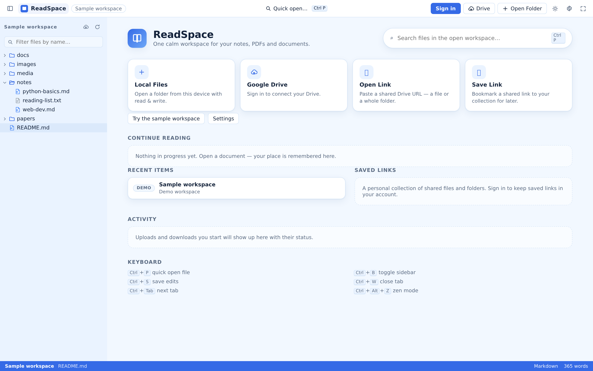
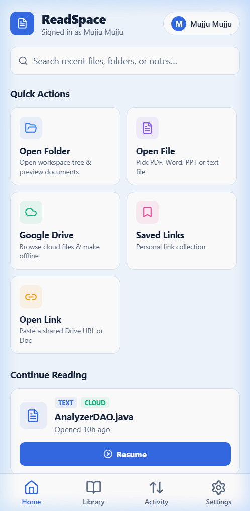

# 1. Platform Overview and Feature Catalog

ReadSpace is an integrated, local-first reading workspace designed to bridge local file systems, personal document archives, and cloud storage into a calm, focused reading environment. Rather than requiring users to upload every file to a remote cloud server before reading, ReadSpace is engineered around the principle of **content autonomy**: your documents stay where they belong—on your local machine, your mobile device, or your personal Google Drive—while ReadSpace provides a unified, distraction-free interface for browsing, reading, annotating, and editing them.

---

## 1.1 The Three Core Architectural Pillars

The ReadSpace platform consists of three distinct software components working in harmony:

```text
┌───────────────────────────────────────────────────────────────────────────┐
│                        ReadSpace Web Application                          │
│        (Vite + React 18 + TypeScript + Tailwind CSS + Zustand)            │
│    • Local Directory Provider (File System Access API / Snapshot Fallback) │
│    • Unified Multi-Tab Document Workbench                                 │
│    • Renderers: Markdown, PDF.js, Mammoth DOCX, PPTX, HTML, Media         │
└─────────────────────┬───────────────────────────────┬─────────────────────┘
                      │                               │
              Direct Browser Access            REST / Cookie API
              (IndexedDB / LocalStorage)       (Sessions & Cloud Proxy)
                      │                               │
                      ▼                               ▼
       ┌────────────────────────────┐   ┌───────────────────────────┐
       │   Local File System /      │   │   Node.js / Express /     │
       │   Device Storage           │   │   Vercel Serverless API   │
       │ • Desktop Folders (FSA)    │   │ • Auth (Scrypt & WebAuthn)│
       │ • Mobile App Storage       │   │ • Google OAuth & Drive    │
       │ • IndexedDB Offline Cache  │   │ • Saved Links & Sessions  │
       └────────────────────────────┘   │ • MongoDB / JSON Storage  │
                      ▲                 └─────────────┬─────────────┘
                      │                               │
           Native File Storage & Cache         REST API Calls
                      │                        (Session Bearer Token)
                      │                               │
┌─────────────────────┴───────────────────────────────┴─────────────────────┐
│                      ReadSpace Mobile Companion                           │
│              (React Native + Expo SDK 52 + TypeScript)                    │
│    • Native File Pickers & Android Storage Access Framework (SAF)         │
│    • HybridReader Engine (Native WebView & Web Viewports)                 │
│    • Offline Document Caching & Metadata Persistence (AsyncStorage)       │
│    • Mobile Library, Reading Mode, and Settings Management                │
└───────────────────────────────────────────────────────────────────────────┘
```

1. **The Desktop & Responsive Web Application:** A browser-based productivity workbench deployed as a high-performance single-page application. It provides a full-featured desktop workspace with directory trees, multi-tab navigation, side-by-side editing, reader customization, and direct integration with local operating system folders.
2. **The Mobile Companion App:** A dedicated React Native application built with Expo SDK 52, designed for smartphones and tablets. It provides touch-optimized reading, document bookmarking, local and cloud library browsing, and offline reading capabilities.
3. **The Backend & Cloud Integration Layer:** A Node.js backend (deployable on Vercel Serverless or dedicated Node hosts) that provides secure user authentication, AES-256 encrypted Google Drive OAuth proxying, workspace session synchronization, and cloud transfer coordination.

---

## 1.2 Visual Overview: Web vs. Mobile

ReadSpace delivers tailored experiences depending on whether you are working at a desktop workstation or reading on a mobile device:

### The Web Workspace Dashboard
The web home serves as your command center, offering one-click access to local directories, connected Google Drive storage, shared document links, recent reading activity, and a preloaded sample workspace for instant exploration.



### The Mobile Companion Experience
The mobile app provides a streamlined, touch-friendly interface structured around Home, Library, Activity, and Settings, allowing you to carry your reading collection wherever you go.



---

## 1.3 Core System Concepts

Understanding ReadSpace requires familiarity with several architectural concepts:

| Term | Technical Meaning & Implementation |
|---|---|
| **Workspace** | An isolated file hierarchy presented to the reader. A workspace can originate from a local folder handle (`fsa`), an uploaded directory snapshot (`fallback`), an authenticated Google Drive folder (`clouddrive`), a shared web resource (`cloudlink`), or the built-in sample project (`sample`). |
| **Provider** | The virtualized file system abstraction layer (`src/services/fs/types.ts`). Providers expose uniform asynchronous methods (`listDir`, `readFile`, `readText`, `writeFile`, `stat`) across heterogeneous backends, hiding underlying protocol differences. |
| **Reader / Viewer** | The format-specific rendering engine loaded by `ViewerHost.tsx`. ReadSpace dynamically mounts dedicated viewer modules for Markdown, PDF, rich text, HTML, presentations, spreadsheets, images, and audio/video media. |
| **Tab Store** | The state machine (`src/stores/tabs.ts`) managing open document buffers. Every opened file receives a persistent tab with tracking for active selection, scroll offset, and unsaved edit state. |
| **Session** | Account-associated metadata representing the user's active workspace configuration (open tabs, active document, panel layout). Session sync coordinates state across sessions without indiscriminately copying entire file contents. |
| **Saved Link** | A curated reference to a remote Google Drive document or shared folder, complete with resource keys, custom titles, collection tags, and reading progress records. |
| **Cloud Transfer** | An explicit, user-initiated file upload or download batch that moves content between local storage and Google Drive via backend-coordinated transfer streams. |
| **Zen Mode** | A specialized UI state that collapses the file explorer sidebar, header navigation, tab bars, and floating controls, leaving an unobstructed viewport focused purely on reading content. |

---

## 1.4 Detailed Capability Matrix

The table below outlines feature availability and implementation depth across all supported deployment targets:

| Functional Area | Web Desktop (Chromium) | Responsive Web (Mobile Browser) | Expo Mobile Companion (Android / iOS) | Implementation Status |
|---|---|---|---|---|
| **Local Folder Browsing** | Full native read/write via File System Access API | Read-only directory input snapshot | Android SAF directory tree; iOS multi-document import | Web observed; Mobile native code-based |
| **Sample Workspace** | Instant zero-install sandbox with Markdown & PDF | Responsive sandbox explorer | Bundled offline assets | Observed live on deployed web |
| **Markdown Reading** | Rendered GitHub-flavored Markdown with syntax highlighting | Responsive Markdown rendering | HybridReader native WebView renderer | Observed live on web; mobile code-based |
| **Text Editing & Saving** | Live Split-View, In-Place Editor, `Ctrl+S` writeback | Full-screen text editor | Read-only document view with search | Web code-based; mobile intentionally view-only |
| **PDF Viewing** | PDF.js engine with zoom, page jump, fit width | Pinch-to-zoom PDF viewer | Embedded native PDF viewer bundle | Observed live on web sample |
| **Office Documents** | DOCX (Mammoth HTML) & PPTX (Slide engine) | Responsive DOCX / PPTX | WebView converted slides and document text | Code-based across all targets |
| **Media Playback** | Native audio player & video container | Mobile HTML5 video/audio | ExoPlayer / AVPlayer via Expo Audio | Code-based across all targets |
| **Themes & Styling** | Ice Blue, Light, Dark, Sepia, System | Dynamic responsive theme switching | Ice Blue, Light, Dark, Sepia native themes | Observed live on web; mobile code-based |
| **Cloud Authentication** | Email/Password, Google OAuth, WebAuthn Passkeys | Email/Password, Google OAuth | Email/Password, Google OAuth | Web code-based; mobile passkey simulated |
| **Google Drive Integration** | Full folder explorer, file reader, guarded writes | Mobile Drive browsing | Drive folder explorer, document caching | Code-based; requires valid OAuth credentials |
| **Offline Availability** | IndexedDB cache, drafts, and handles | Browser cache storage | AsyncStorage metadata + cached document files | Code-based; subject to platform cache limits |

---

## 1.5 Explicit Architectural Boundaries

To ensure clear operational expectations, the following boundaries govern the ReadSpace design:

1. **Local-First, Not Cloud-Mandatory:** ReadSpace does not require an account or cloud connection for local file reading. You can open, read, and edit local files entirely offline without sending a single byte over the network.
2. **Explicit Transfer vs. Automatic Two-Way Sync:** ReadSpace is **not** a continuous synchronization daemon like Dropbox or Google Drive for Desktop. Files are scanned and compared on demand; uploading or downloading requires explicit user review and confirmation.
3. **Provider Permissions Determine Write Access:** While ReadSpace supports editing Markdown, plain text, and HTML, changes can only be saved back to disk if the underlying provider supports writes (such as Chromium's File System Access API or authenticated Google Drive). Read-only providers automatically route edits to browser downloads to prevent data loss.
4. **Office File Conversion vs. Native Suite Fidelity:** DOCX and PPTX files are rendered through client-side parsing engines (Mammoth and a custom slide interpreter). They provide fast, clean reading views but do not guarantee 100% typographical parity with desktop Microsoft Office or Adobe InDesign layouts.
5. **Session Coordination vs. Binary Replication:** Synchronizing a workspace session stores metadata (which files are open, active tab, scroll percentage). It does not automatically transfer gigabytes of local PDF files between devices.

---

## 1.6 Intended User Personas

- **Students & Researchers:** Aggregate lecture slides (PPTX), academic papers (PDF), and course notes (Markdown) into organized study workspaces without cluttering their local file system with redundant copies.
- **Software Developers & Technical Writers:** Review software documentation, architectural specifications, configuration files, and code repositories in a serene, distraction-free reading environment.
- **Writers & Note-Takers:** Draft, refine, and edit Markdown notes side-by-side with live HTML preview rendering, saving directly to local disk or personal cloud storage.
- **Mobile Readers:** Cache documents on their mobile devices for offline reading during commutes, flights, or field work.

---

**Codebase References:**
- Web Shell & Routing: [src/App.tsx](file:///d:/AVTIVE%20PROJ/readspace/src/App.tsx)
- Unified Viewer Host: [src/components/ViewerHost.tsx](file:///d:/AVTIVE%20PROJ/readspace/src/components/ViewerHost.tsx)
- Virtual File System Providers: [src/services/fs/](file:///d:/AVTIVE%20PROJ/readspace/src/services/fs/)
- Mobile Navigator: [readspace_app/src/navigation/RootNavigator.tsx](file:///d:/AVTIVE%20PROJ/readspace/readspace_app/src/navigation/RootNavigator.tsx)
- Backend Router: [server/lib/routes.mjs](file:///d:/AVTIVE%20PROJ/readspace/server/lib/routes.mjs)
