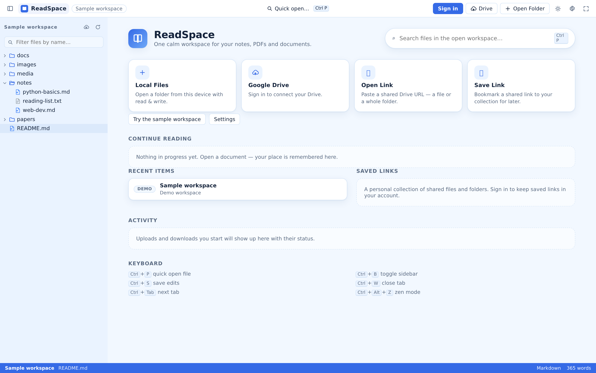
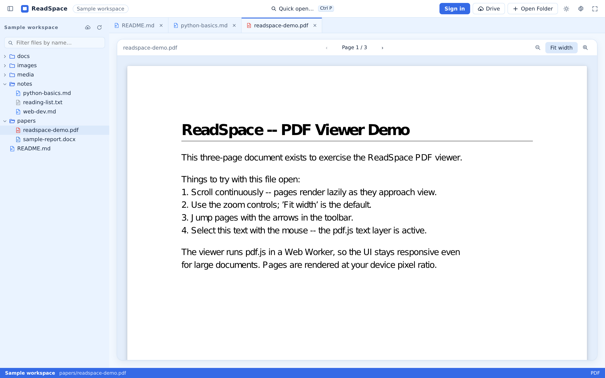
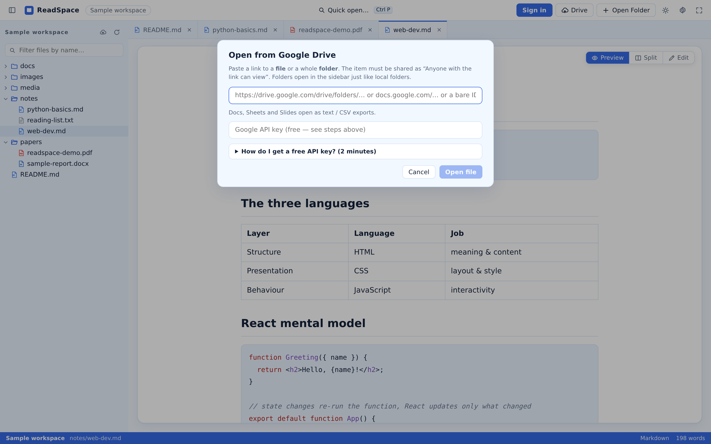
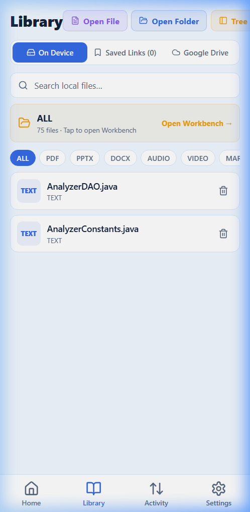

# 2. Getting Started and Account Setup

This guide walks you through setting up and using ReadSpace across both the Web platform and the Mobile companion app, covering initial exploration, local directory access, user accounts, and Google Drive cloud connectivity.

---

## 2.1 First Visit on the Web

You can experience ReadSpace immediately in any modern web browser without creating an account or installing any software.

### Step 1: Open the Application
Navigate to your deployed ReadSpace instance (e.g., `https://readspace-livid.vercel.app/` or your local development server at `http://localhost:5173/`).

The home screen presents your reading dashboard with quick-action cards:



### Step 2: Explore the Built-In Sample Workspace
Click **Try the sample workspace** on the home dashboard. The app instantly mounts an in-memory virtual workspace pre-loaded with curated sample documents:

1. The left **File Explorer** expands to show a directory hierarchy including `papers/`, `guides/`, and `README.md`.
2. Click **README.md** (or the **Open sample README** banner). The Markdown viewer loads instantly, showcasing rendered headers, interactive code blocks, tables, and typography.
3. In the explorer, expand the `papers/` folder and click `readspace-demo.pdf`.



4. Test the PDF controls located in the viewer header:
   - Use the **Page Navigation** controls (`<` and `>`) or type a page number directly into the input box.
   - Adjust magnification using the **Zoom In** (`+`), **Zoom Out** (`-`), and **Fit to Width** toggle buttons.
5. Return to the home screen at any time by clicking the **ReadSpace** logo in the top-left navigation bar.

> [!NOTE]
> The sample workspace runs entirely in browser memory. It is designed for hands-on evaluation and demonstration; changes made to sample files are not saved to your personal computer.

---

## 2.2 Opening a Local Folder on the Web

ReadSpace allows you to turn any folder on your computer into an interactive reading library.

### Step 1: Trigger the Folder Picker
From the home dashboard, click the **Local Files** card, or click **Open Folder** in the top navigation bar at any time.

### Step 2: Grant Browser Directory Access
Your browser will present a native operating system folder selection dialog:

1. Select your target document folder (e.g., your `Documents/Courses`, `Books`, or `Research` folder).
2. Click **Select Folder** (or **Upload** on some operating systems).
3. If your browser supports the Chromium **File System Access API**, a security permission dialog will appear:
   - *"Let ReadSpace view and save changes to files in this folder?"*
   - Click **View Files** (or **Edit Files** if you intend to modify notes).

```text
Browser Security Flow (Chromium):
User Clicks "Open Folder"
       │
       ▼
Native OS Directory Picker
       │
       ▼
Browser Permission Prompt:
[ Read-only Access ]  ──▶  Safe Browsing (Edits download copies)
[ Read-Write Access ] ──▶  Direct Disk Persistence (Ctrl+S updates disk)
```

### Step 3: Browse and Read
The left sidebar immediately populates with your folder structure:
- Click folder arrows to expand and collapse subdirectories.
- Click any supported file (Markdown, PDF, DOCX, PPTX, HTML, plain text, image, audio, or video) to open it in a dedicated reader tab.
- Filter files in real time by typing into the filter input at the top of the file tree.

### File System Provider Behaviors & Permissions

| Browser Engine | Technology Used | Write Capability | Session Persistence |
|---|---|---|---|
| **Google Chrome / MS Edge / Brave / Opera** (Desktop) | File System Access API (`showDirectoryPicker`) | **Full Read & Write:** Direct file modification on disk via `FileSystemWritableFileStream`. | Handles stored in IndexedDB. On browser restart, click **Verify Permission** to resume. |
| **Mozilla Firefox / Apple Safari** (Desktop & Mobile) | WebKit Directory Input (`<input type="file" webkitdirectory>`) | **Read-Only Snapshot:** All files are buffered in memory and IndexedDB. | Files remain available during the active tab session. Editing a file offers an automatic file download. |

> [!TIP]
> If you make textual edits while using a browser with read-only folder permissions, pressing `Ctrl+S` will trigger an automated browser download of your updated file so your work is never lost.

---

## 2.3 User Accounts and Authentication

ReadSpace functions seamlessly as an offline reader, but creating an account unlocks cross-device session synchronization, Google Drive integration, and cloud-saved reading references.

### Account Creation and Sign-In Options

Click **Sign In** in the top navigation bar to open the authentication modal:

```text
                    ┌────────────────────────────────────┐
                    │       ReadSpace Authentication     │
                    ├────────────────────────────────────┤
                    │  [ Continue with Google ]          │
                    │  ────────────── OR ──────────────  │
                    │  Email:    [ user@example.com    ] │
                    │  Password: [ ••••••••••••••••••  ] │
                    │  [ Sign In ]      [ Create Account]│
                    │  ────────────── OR ──────────────  │
                    │  [ Sign in with Passkey / WebAuthn]│
                    └────────────────────────────────────┘
```

1. **Email & Password Registration:**
   - Enter your email address and a secure password (minimum 6 characters; 12+ recommended).
   - Passwords are encrypted on the backend using salted **Scrypt** key derivation.
2. **Google Identity Sign-In:**
   - Click **Continue with Google** to authenticate with your existing Google identity via OAuth 2.0.
   - This authenticates your ReadSpace account identity.
3. **Hardware Passkeys (WebAuthn):**
   - After signing in, navigate to **Account Settings → Security** and click **Register Passkey**.
   - Follow your operating system's platform authenticator prompt (Windows Hello, Apple Touch ID / Face ID, or a FIDO2 security key).
   - On future visits, click **Sign in with Passkey** for instant, passwordless biometric login.

---

## 2.4 Connecting Google Drive

Connecting Google Drive allows you to browse cloud folders, read cloud PDFs, edit cloud notes with conflict detection, and transfer files between your PC and Google Drive.

> [!IMPORTANT]
> **Authentication vs. Cloud Storage Authorization:** Signing in with your Google account confirms who you are. Authorizing Google Drive is a separate, explicit permission step that grants ReadSpace access to your Drive files.

### Step-by-Step Drive Connection Flow

1. Open the Drive connection modal by clicking **Google Drive** on the home screen or selecting **Connect Google Drive** from the account dropdown.



2. Click **Connect Google Drive**.
3. Google will present the OAuth consent screen requesting access to your files (`drive.file` and `drive.readonly` scopes).
4. Review the requested permissions and click **Allow**.
5. Upon redirecting back to ReadSpace, the Drive status indicator in the top toolbar will change to a green **Connected** badge.
6. Click **Browse Google Drive** to explore your cloud directories directly inside the ReadSpace workspace explorer.

---

## 2.5 Mobile Companion Initial Setup

The ReadSpace Mobile Companion is built for Android, iOS, and mobile web using React Native and Expo SDK 52.

### Step 1: Launch the Mobile App
Open the app on your mobile device. The navigation bar at the bottom provides four primary tabs:
- **Home:** Quick actions, recent reading items, and cloud status.
- **Library:** Tabbed explorer for On-Device files, Saved Links, and Google Drive.
- **Activity:** Transfer status and recent sync operations.
- **Settings:** Appearance themes, backend server connection, and cache controls.



### Step 2: Configure the Backend Server Connection
If you are hosting your own ReadSpace backend or using a private server:
1. Tap the **Settings** tab.
2. Scroll to **Backend Server URL**.
3. Enter your backend URL (e.g., `https://readspace-livid.vercel.app` or your private server address).
4. Tap **Test Connection** to confirm network reachability and API status.

### Step 3: Grant File Storage Permissions
- **Android:** When opening your first local folder, Android will prompt you to select a directory using the **Storage Access Framework (SAF)**. Tap **Use this folder** and then tap **Allow** to give ReadSpace persistent access to your documents.
- **iOS:** Due to iOS security sandboxing, tap **Open File** or **Open Folder** to invoke the native iOS document picker. Multiple files can be selected simultaneously to form an imported mobile reading collection.

---

## 2.6 Setup Troubleshooting & Common Resolutions

| Issue | Root Cause | Recommended Action |
|---|---|---|
| **"Permission Expired" on local folder reload** | Modern browsers revoke active directory handles when a tab is closed or idle. | Click **Verify Permission** in the explorer header to quickly re-grant access with a single click. |
| **Edits download a copy instead of saving to disk** | The folder was opened in a browser using read-only snapshot mode (Firefox/Safari) or write permission was denied. | Use Google Chrome or Microsoft Edge if direct disk writing is required, or keep the downloaded copy. |
| **Google Drive connection fails or hangs** | OAuth redirect URI mismatch or browser popup blocker. | Ensure popup blockers are disabled for ReadSpace. Verify your `GOOGLE_REDIRECT_URI` environment variable if self-hosting. |
| **Mobile app cannot connect to backend** | Network firewall or invalid backend URL. | Go to mobile **Settings**, enter the exact HTTPS URL of your deployment, and tap **Test Connection**. |
| **Local files missing after clearing browser data** | IndexedDB or localStorage was purged by your browser or a cleaner utility. | Simply click **Open Folder** and re-select your directory; all files remain safely on your hard drive. |

---

**Codebase References:**
- Web Welcome Screen: [src/components/viewers/Welcome.tsx](file:///d:/AVTIVE%20PROJ/readspace/src/App.tsx)
- Web Auth Modals: [src/components/auth/](file:///d:/AVTIVE%20PROJ/readspace/src/)
- File System Open Dispatcher: [src/services/fs/open.ts](file:///d:/AVTIVE%20PROJ/readspace/src/services/fs/open.ts)
- Mobile Settings Screen: [readspace_app/src/screens/SettingsScreen.tsx](file:///d:/AVTIVE%20PROJ/readspace/readspace_app/src/screens/SettingsScreen.tsx)
- Mobile Storage Service: [readspace_app/src/services/storage.ts](file:///d:/AVTIVE%20PROJ/readspace/readspace_app/src/services/storage.ts)
