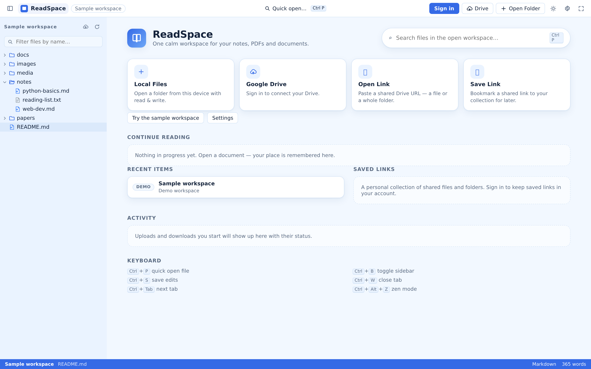
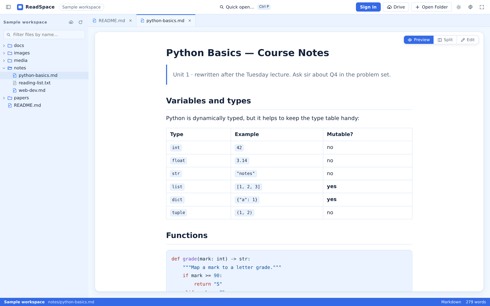
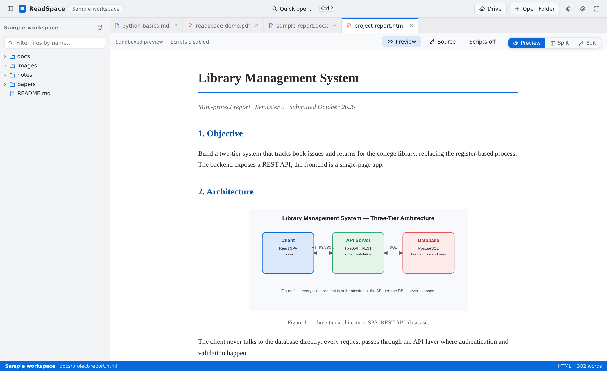
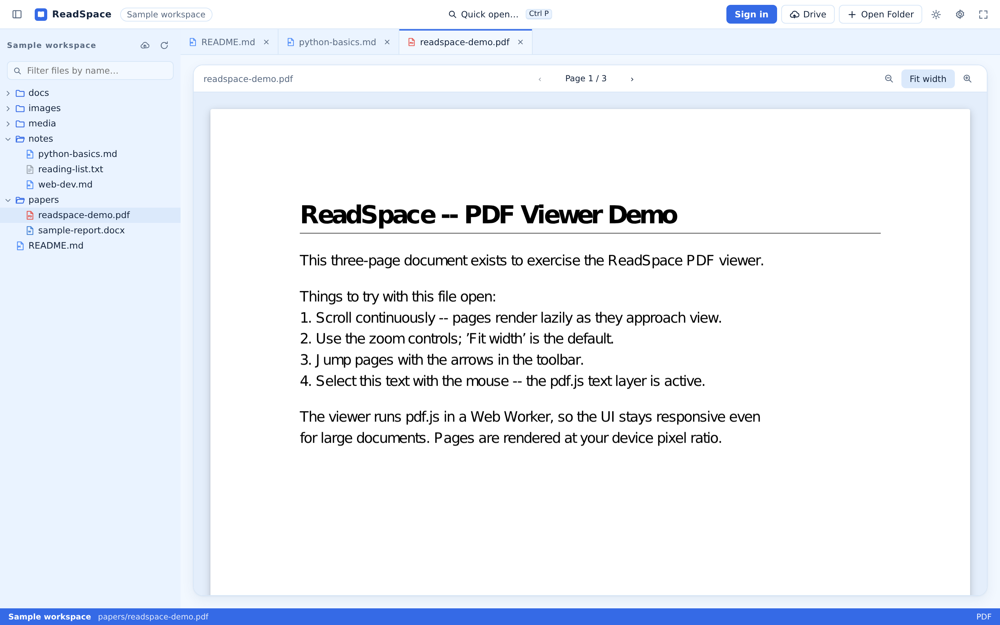
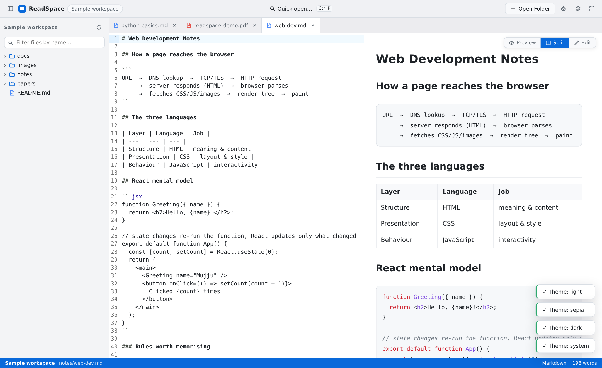
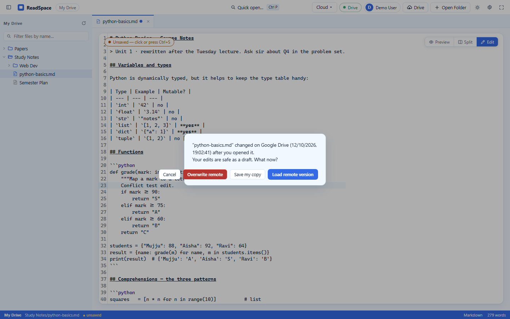
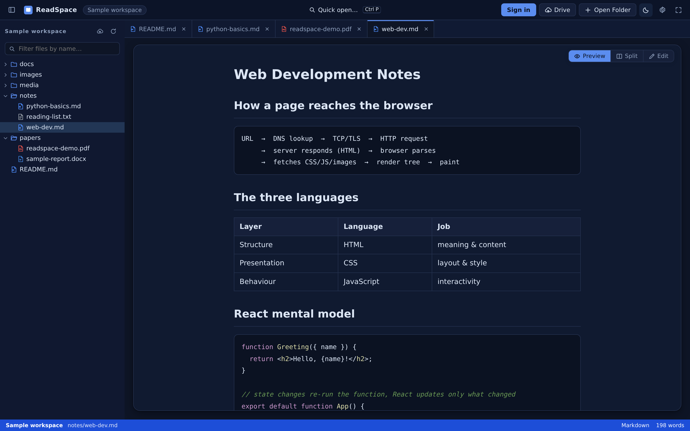
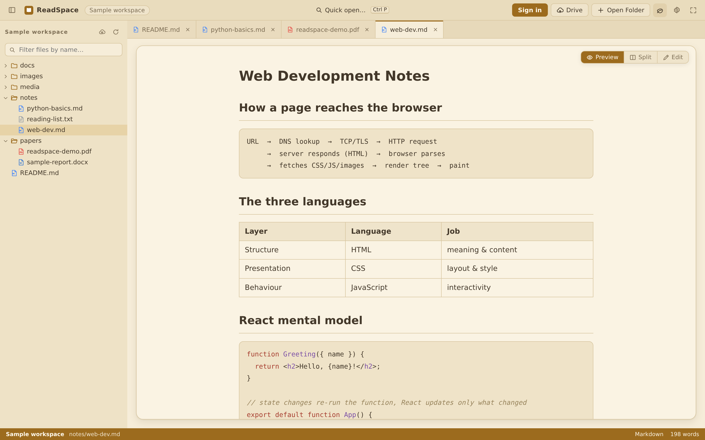

# 3. Web Application User Guide

The ReadSpace Web Application is a desktop-class document workbench and reading environment designed to run seamlessly in modern web browsers. It combines virtualized directory browsing, multi-tab buffer management, format-specialized document renderers, side-by-side editing, and personalized reading environments into a cohesive desktop experience.

---

## 3.1 The Home Dashboard and Global Navigation

The ReadSpace Home view acts as your central launchpad, welcoming you with recent reading history, quick-access storage providers, and cloud status indicators.



### Key Dashboard Sections:
1. **Quick Actions Grid:**
   - **Local Files:** Launches the native operating system directory picker to mount a local folder into your active workspace.
   - **Google Drive:** Opens the cloud management modal to browse authenticated Drive hierarchies or connect a new account.
   - **Open Link / Save Link:** Fast inputs to load public Google Drive files or save remote references to your personal reading library.
   - **Try the sample workspace:** Instantly launches an interactive in-browser demonstration workspace containing sample Markdown guides and academic PDFs.
2. **Continue Reading:** A dynamic card displaying the last active document, its parent directory path, file format badge, and last-read timestamp.
3. **Recent Documents:** A chronological list of recently opened files across all accessed workspaces. Clicking any recent item instantly reopens that document and restores your previous scroll position.
4. **Saved Links & Cloud Bookmarks:** A persistent repository of remote Google Drive document references, complete with custom labels and collection tags.
5. **Activity Log:** A summary of recent local scans, uploads, downloads, and cloud transfer events.

### Global Top Navigation Bar:
- **Brand / Home Button:** Navigates back to the main dashboard without closing your open document tabs.
- **Quick Open (`Ctrl+P` / `Cmd+P`):** Opens the fuzzy file search dialog to quickly find and switch files across large workspaces.
- **Open Folder:** Triggers the native folder picker to switch or open a new local directory.
- **Google Drive Status:** Displays current cloud connectivity (`Connected`, `Sandbox`, or `Disconnected`) and allows one-click folder browsing.
- **Theme Switcher:** Toggles instantly between **Ice Blue**, **Light**, **Dark**, and **Sepia** visual modes.
- **Reader Settings:** Opens the typography, line height, layout width, and font family configuration drawer.
- **Zen Mode Toggle (`Ctrl+Alt+Z`):** Hides all extraneous interface chrome for an immersive, distraction-free reading session.
- **Account Avatar / Sign In:** Manages account profile, WebAuthn passkeys, password updates, and session logout.

---

## 3.2 Workspace Explorer & File Navigation

When a workspace is mounted—whether from a local folder, Google Drive, or the sample project—the left sidebar displays the **Workspace Explorer**.



### Explorer Capabilities:
- **Collapsible Hierarchical Tree:** Expand and collapse directories with smooth animations. Folder state is remembered as you navigate.
- **Real-Time Name Filtering:** Type into the filter input at the top of the tree to filter filenames instantaneously using fuzzy matching.
- **Automated Noise Exclusion:** ReadSpace automatically filters out clutter and developer artifacts, hiding `.git/`, `node_modules/`, `.venv/`, `.DS_Store`, `dist/`, and build artifacts from your view.
- **Hidden File Visibility:** Toggle whether dotfiles (e.g., `.env`, `.gitignore`) are displayed via Reader Settings.
- **Resizable Sidebar:** Drag the right border of the explorer to adjust sidebar width to your preferred layout. Press `Ctrl+B` to collapse or expand the sidebar entirely.

---

## 3.3 The Tab System and Quick Open

ReadSpace features a tabbed buffer management system (`src/stores/tabs.ts`) optimized for intensive research across multiple documents.



### Tab System Features:
- **Automatic Buffer Allocation:** Opening any document from the explorer allocates a dedicated tab.
- **Duplicate Prevention:** Clicking an already open file smoothly transitions focus to its existing tab without creating duplicate buffers.
- **Tab Drag & Reordering:** Drag tabs horizontally along the tab bar to organize your reading priority.
- **Dirty State Indicator:** When modifying editable files (Markdown, text, HTML), an orange dot indicator appears on the tab, signaling unsaved changes.
- **Close Protection:** Attempting to close a tab with unsaved edits triggers a confirmation modal: *"You have unsaved changes. Discard or Save?"*
- **Quick Open (`Ctrl+P`):** Pressing `Ctrl+P` (or `Cmd+P` on macOS) opens a modal search input. As you type, ReadSpace searches your entire workspace file index, allowing you to switch between files in milliseconds without touching your mouse.

---

## 3.4 Document Viewers and Format Capabilities

ReadSpace delegates document rendering to specialized client-side viewer components mounted inside `ViewerHost.tsx`:

```text
                                ViewerHost.tsx
                                      │
           ┌──────────────────────────┼──────────────────────────┐
           ▼                          ▼                          ▼
   MarkdownViewer.tsx          PdfViewer.tsx             DocxViewer.tsx
   • GitHub-Flavored MD        • PDF.js Engine           • Mammoth.js Parser
   • Syntax Highlighted Code   • Continuous Scroll       • HTML Style Mapping
   • Math / Tables / Checkboxes• Zoom / Fit Width        • Embedded Images
           │                          │                          │
           ▼                          ▼                          ▼
   PptxViewer.tsx              HtmlViewer.tsx            MediaViewer.tsx
   • Slide Engine              • Sandboxed Iframe        • HTML5 Audio Player
   • Slide Thumbnails          • Script Toggle           • HTML5 Video Player
   • Slide Navigation          • Security Boundary       • Native Image Zoom
```

### 1. Markdown (`.md`, `.markdown`, `.mdx`)
Renders rich formatted documentation including headers, bold/italic formatting, inline code, fenced code blocks with syntax highlighting, ordered and bullet lists, GitHub task lists (`- [x]`), blockquotes, tables, and embedded images. Links to other workspace files can be clicked to open them directly in adjacent tabs.

### 2. Portable Document Format (`.pdf`)
Powered by Mozilla's high-fidelity `pdf.js` engine:



- **Fluid Pagination:** Browse documents page by page or scroll continuously.
- **Zoom & Fit Controls:** Instantly toggle between **Fit to Width**, **Fit to Page**, or manual zoom percentages (50% to 300%).
- **Page Jump:** Type any page number into the pagination box to jump directly to target sections.
- **High-DPI Canvas Rendering:** Ensures crystal-clear font rendering on Retina and 4K displays.

### 3. Source Code and Plain Text (`.txt`, `.js`, `.ts`, `.py`, `.json`, `.css`, etc.)
Provides syntax highlighting for over 30 programming and configuration languages with custom font ligatures, line numbering, and automatic line wrapping.

### 4. HTML Documents (`.html`, `.htm`)
Renders HTML inside an isolated, secure `<iframe>` container. To protect user security, script execution is disabled by default (`sandbox="allow-same-origin"`). Users can explicitly enable JavaScript execution for interactive diagrams or web pages using the **Enable Scripts** toggle button in the viewer header.

### 5. Microsoft Word (`.docx`)
Uses Mammoth to convert `.docx` document XML structures into semantic HTML, faithfully displaying headings, paragraphs, bold/italic formatting, bulleted lists, tables, and embedded images.

### 6. Presentations (`.pptx` / `.ppt`)
Utilizes a custom presentation slide engine that parses presentation archives and presents each slide sequentially with thumbnail navigation and fullscreen slide presentation mode. Legacy `.ppt` files utilize an emergency text and structure extraction fallback.

### 7. Images and Media (`.png`, `.jpg`, `.svg`, `.mp4`, `.mp3`, etc.)
Displays high-resolution raster and vector images with pan-and-zoom controls. Audio and video files utilize native HTML5 media controls with timeline scrubbing, playback rate adjustment, and volume control.

---

## 3.5 Editing, Split-View, and Saving

For textual document formats (Markdown, plain text, HTML, JSON, CSS, and source code), ReadSpace transforms from a passive reader into a powerful writing environment.

### The Three Editor View Modes:
1. **Preview Mode:** Displays the fully rendered document (e.g., stylized Markdown or HTML).
2. **Edit Mode:** Displays a clean, distraction-free code and text editor.
3. **Split View Mode:** Positions the editor on the left and live rendered output on the right, synchronizing changes in real time.



### Saving Changes and Disk Persistence:
- **Keyboard Shortcut (`Ctrl+S` / `Cmd+S`):** Triggers an immediate write operation.
- **Local Folder Access (Chromium FSA):** Writes the modified text stream directly back to your physical file on disk via `FileSystemWritableFileStream`. The dirty indicator clears instantly.
- **Google Drive Workspaces:** Submits an authenticated `PATCH /api/drive/files/:id` request to Google Drive containing the updated text and the expected `modifiedTime`.
- **Automatic Draft Recovery:** ReadSpace continuously debounces and saves in-flight edits to browser IndexedDB storage (`src/services/persistence.ts`). If your computer loses power or the tab is accidentally closed, reopening the document prompts you to restore your draft.

### Cloud Concurrency & Conflict Detection:
When editing a document in a shared Google Drive workspace, ReadSpace monitors file modification timestamps. If another user or device modifies the cloud file before you save, ReadSpace intercepts the save and presents the **Cloud Conflict Dialog**:



You are offered three distinct resolution paths:
1. **Overwrite Remote:** Forces your local edits onto Google Drive, updating the cloud file.
2. **Save My Copy:** Saves your edits as a separate timestamped duplicate file in the same folder (e.g., `README (conflict-copy).md`), preserving both versions.
3. **Load Remote Version:** Discards your local unsaved draft and pulls the latest cloud version from Google Drive.

---

## 3.6 Personalization, Themes, and Zen Mode

ReadSpace is built for visual comfort during prolonged reading sessions.

### Themes:
Click the theme icon in the top toolbar to switch between four hand-crafted palettes:

| Theme | Visual Profile & Best Use Case |
|---|---|
| **Ice Blue (Default)** | Cool slate-blue undertones with soft high-contrast typography. Optimal for daytime reading and technical documentation. |
| **Light** | Clean, minimalist paper-white background with charcoal text. |
| **Dark** | Deep navy/charcoal background (`#0b1320`) with soft silver typography. Eliminates eye strain in low-light environments. |
| **Sepia** | Warm parchment tones (`#f4ecd8`) mimicking physical book paper. Ideal for reading long-form literature and academic papers. |

### Theme Comparisons:

#### Dark Theme


#### Sepia Theme


### Reader Typography Customization:
Click the **Settings** icon in the toolbar to adjust:
- **Font Family:** System Sans-Serif, Elegant Serif (Merriweather / Georgia), or Monospace (Fira Code / Consolas).
- **Font Size:** 12px to 24px slider for comfortable legibility.
- **Line Height:** Compact (1.4), Standard (1.6), or Spacious (1.9) line spacing.
- **Content Width:** Constrain maximum text width (e.g., 65ch to 90ch) to optimize reading velocity and avoid eye fatigue on ultrawide monitors.

### Zen Mode (`Ctrl+Alt+Z`):
Zen Mode strips away all peripheral visual noise:
- The explorer sidebar collapses completely.
- Top navigation headers, action buttons, and status bars disappear.
- Margins automatically center around your text.
- To exit Zen Mode, press `Ctrl+Alt+Z` or hover over the top-right corner to reveal the **Exit Zen** floating button.

---

## 3.7 Complete Keyboard Shortcuts Reference

| Shortcut (Windows/Linux) | Shortcut (macOS) | Action Performed |
|---|---|---|
| `Ctrl+P` | `Cmd+P` | Open Quick Open fuzzy file finder |
| `Ctrl+B` | `Cmd+B` | Toggle Workspace File Explorer sidebar |
| `Ctrl+S` | `Cmd+S` | Save current document edits to disk / Drive |
| `Ctrl+W` | `Cmd+W` | Close the active document tab |
| `Ctrl+Tab` | `Ctrl+Tab` | Cycle to the next open document tab |
| `Ctrl+Shift+Tab` | `Ctrl+Shift+Tab` | Cycle to the previous open document tab |
| `Ctrl+Alt+Z` | `Cmd+Option+Z` | Toggle Zen distraction-free reading mode |
| `Escape` | `Escape` | Close active dialog, modal, or Quick Open search |

---

**Codebase References:**
- Tab State Store: [src/stores/tabs.ts](file:///d:/AVTIVE%20PROJ/readspace/src/stores/tabs.ts)
- Reader Settings Store: [src/stores/settings.ts](file:///d:/AVTIVE%20PROJ/readspace/src/stores/settings.ts)
- Local Persistence Service: [src/services/persistence.ts](file:///d:/AVTIVE%20PROJ/readspace/src/services/persistence.ts)
- File System Abstraction: [src/services/fs/](file:///d:/AVTIVE%20PROJ/readspace/src/services/fs/)
- Viewer Host Controller: [src/components/ViewerHost.tsx](file:///d:/AVTIVE%20PROJ/readspace/src/components/ViewerHost.tsx)
- Markdown Viewer: [src/components/viewers/MarkdownViewer.tsx](file:///d:/AVTIVE%20PROJ/readspace/src/components/viewers/)
- PDF Viewer: [src/components/viewers/PdfViewer.tsx](file:///d:/AVTIVE%20PROJ/readspace/src/components/viewers/)
