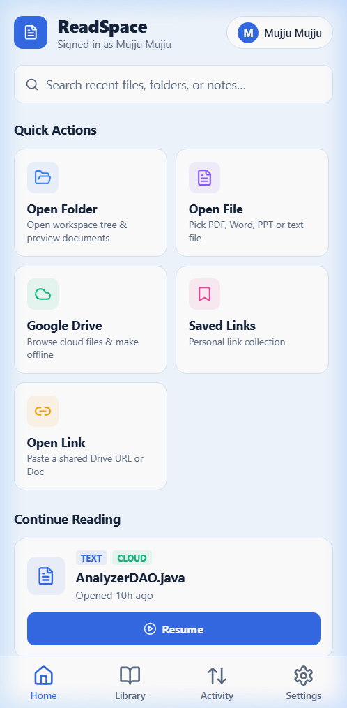
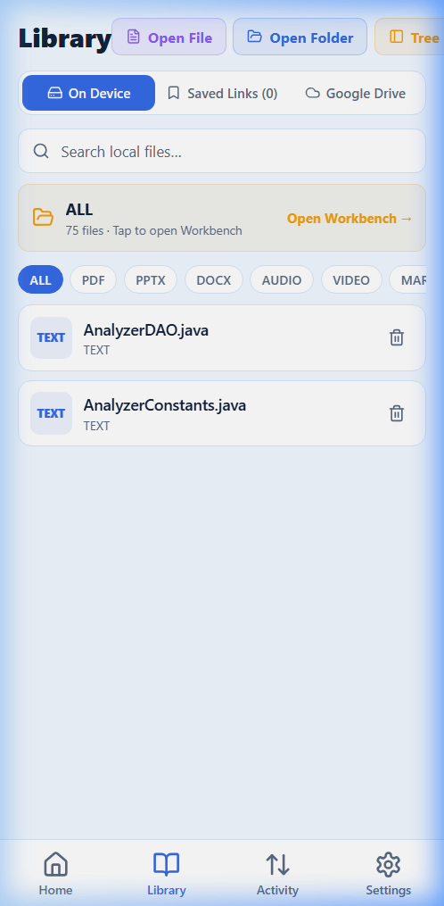
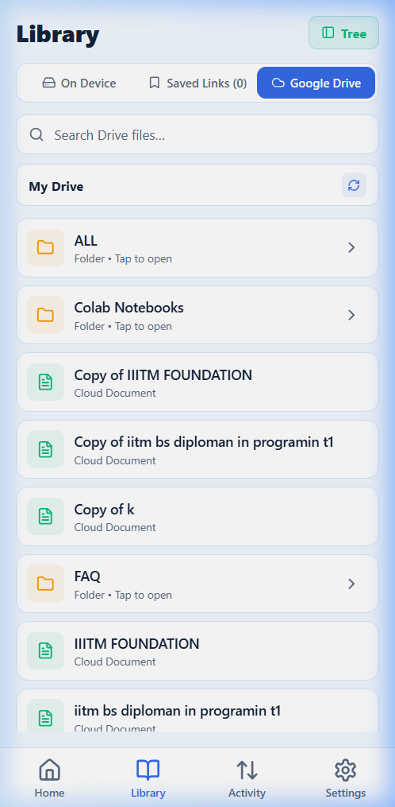
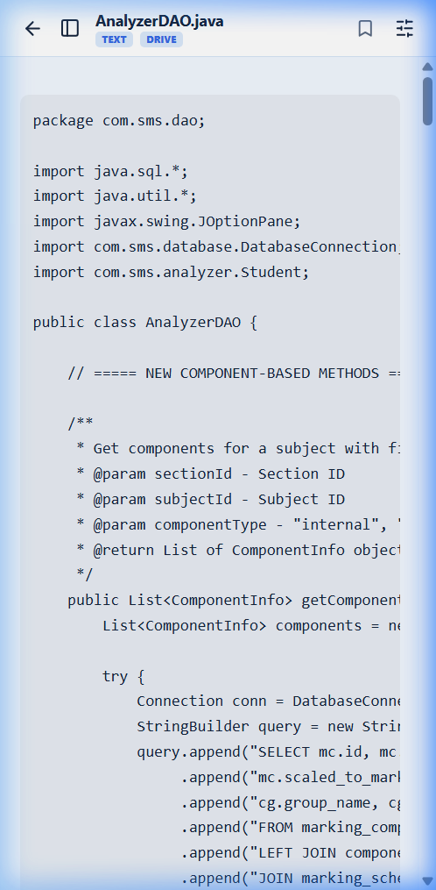
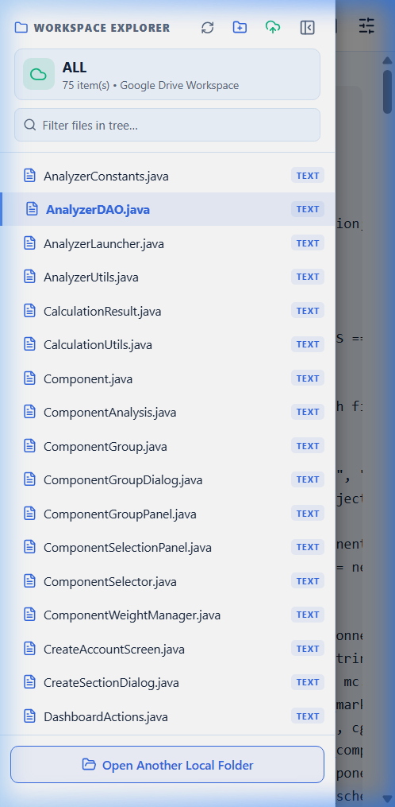
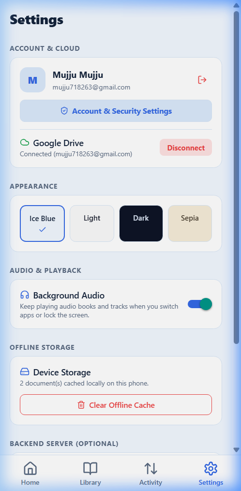
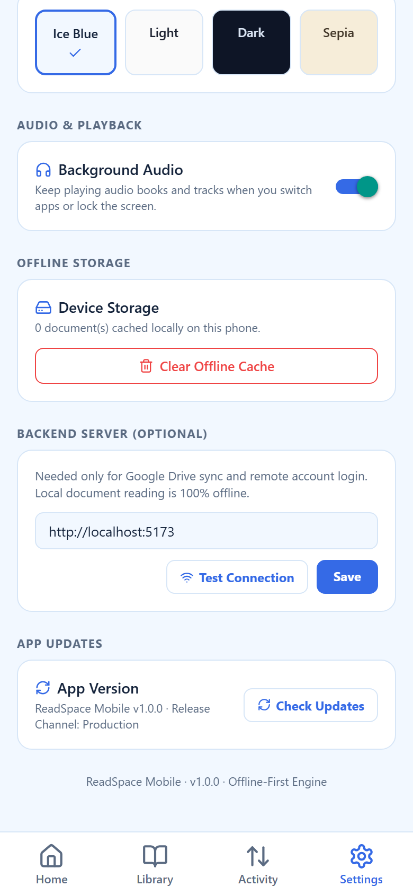

# 4. Mobile Companion Guide

The ReadSpace Mobile Companion is a native-oriented mobile application developed with **React Native** and **Expo SDK 52**. It allows readers to carry their documents, course materials, and personal cloud libraries with them on smartphones and tablets, offering touch-optimized navigation, offline caching, and distraction-free reading modes.

---

## 4.1 Native Mobile Architecture vs. Responsive Web

It is essential to distinguish between accessing ReadSpace via a mobile web browser and using the dedicated Expo Mobile Companion app:

```text
┌──────────────────────────────────────┐  ┌──────────────────────────────────────┐
│       Responsive Web in Browser      │  │        Expo Mobile Companion App     │
│   (Chrome / Safari on iOS/Android)   │  │        (Installed Native / Web APK)  │
├──────────────────────────────────────┤  ├──────────────────────────────────────┤
│ • Runs inside browser sandbox        │  │ • Native Android / iOS application   │
│ • WebKit / Blink rendering engine    │  │ • HybridReader (WebView + DOM engine)│
│ • Ephemeral browser cache & quota    │  │ • Persistent AsyncStorage & FS cache │
│ • No native background audio thread  │  │ • Background audio capabilities      │
│ • Desktop-derived responsive layout  │  │ • Native bottom tabs & drawer trees  │
└──────────────────────────────────────┘  └──────────────────────────────────────┘
```

The Mobile Companion codebase (`readspaceapp`) provides a purpose-built mobile interface divided into four primary navigation tabs plus an immersive Reader view:



1. **Home:** Features quick-access shortcuts (**Open File**, **Open Folder**, **Connect Drive**, **Paste Link**), a **Continue Reading** prompt for your last opened file, and a summary of your local reading collection.
2. **Library:** A three-way tabbed library manager providing browsable hierarchies for **On Device** files, **Saved Links**, and connected **Google Drive** storage.
3. **Activity:** Overview of recent synchronization actions and transfer jobs.
4. **Settings:** Complete configuration panel for themes, backend API endpoints, storage cache purging, and application updates.
5. **Reader:** A specialized, full-screen reading screen with slide-out workspace navigation, bookmarking, and Zen mode.

---

## 4.2 Opening Local Files and Collections

The Mobile Companion adapts its storage access strategies depending on the host operating system:

### 1. Opening Individual Documents
- Tap **Open File** on Home or Library.
- The app invokes the native OS file picker (`expo-document-picker`), allowing you to select any PDF, Markdown, DOCX, PPTX, text file, image, or media file from your device or cloud storage providers (Files app on iOS; Files / Downloads on Android).
- Selected files are copied to the application's local cache directory, cataloged in `AsyncStorage`, and immediately mounted in the Reader.

### 2. Opening Entire Folders and Workspaces
Managing multi-file collections differs across platforms due to operating system security models:



- **Android (Storage Access Framework - SAF):**
  When you tap **Open Folder**, ReadSpace invokes the Android SAF directory picker. Once you grant access to a directory (e.g., your `Downloads/Books` folder), ReadSpace gains persistent permission to traverse subdirectories, read documents, and index nested workspace structures.
- **iOS (Multi-Document Collection Fallback):**
  iOS restricts arbitrary folder-tree traversal for sandboxed apps. ReadSpace provides a multi-document import selector, allowing you to select multiple files simultaneously to generate an in-app virtual workspace folder.
- **Mobile Web (Expo Web Target):**
  Uses the standard HTML5 `<input type="file" webkitdirectory>` element, populating an in-memory directory index persisted to browser IndexedDB.

---

## 4.3 Cloud and Google Drive Integration

When connected to a ReadSpace backend instance, the Mobile Companion becomes a portable cloud reader:



### Features of the Cloud Library:
- **Drive Folder Traversal:** Tap the **Google Drive** tab within the Library screen to browse remote folders, shared drives, and personal archives.
- **On-Demand Document Caching:** Tapping a remote document streams its content from Google Drive through the backend API (`/api/drive/files/:id/content`). The file is cached locally so you can continue reading even if you subsequently lose internet connectivity.
- **Saved Links Repository:** Displays your curated cloud bookmarks. Tapping a saved link fetches the document using its stored Google Drive resource key.

---

## 4.4 The Mobile Reader Experience

Opening any document transitions the interface to the full-screen **Reader Screen**, engineered specifically for legibility and touch ergonomics.

### Reading Mode
In Reading Mode, extraneous chrome is removed, leaving clean typography, comfortable line spacing, and a subtle format badge at the top:



### Slide-Out Workspace Drawer
When reading inside a multi-file folder or workspace, tapping the **Folder Tree** icon in the top header slides out the workspace drawer:



From this drawer, you can:
- View the complete directory hierarchy of your current workspace.
- Seamlessly jump between chapters, related documents, or lecture slides with a single tap.
- Filter files in real time using the search bar at the top of the drawer.

### Core Reader Controls:
- **Zen Mode:** Tap the Zen icon to hide all navigation headers and status indicators. An unobtrusive floating button labeled **Exit Zen** allows you to restore standard controls at any time.
- **Bookmarks:** Tap the bookmark icon to save your current document and scroll offset into your local bookmarked list.
- **Reader Settings:** Adjust font size, line spacing, and color schemes on the fly to suit your ambient lighting conditions.

---

## 4.5 Settings, Storage, and App Updates

The **Settings Tab** provides granular control over the mobile companion's operational environment:



### 1. Appearance and Themes
Switch instantly between **Ice Blue**, **Light**, **Dark**, and **Sepia**. Themes apply universally across all navigation tabs, modal sheets, and the HybridReader engine.

### 2. Backend Server Configuration
- **Backend Server URL:** Configure the HTTPS endpoint of your ReadSpace server (defaults to `https://readspace-livid.vercel.app`).
- **Test Connection:** Pings the `/api/config` endpoint to verify network reachability, API version, and Google OAuth status.

### 3. Application Updates
ReadSpace integrates automated update checking to ensure your mobile client stays current:



- **Expo Over-The-Air (OTA) Updates:** In production builds with Expo Updates enabled, ReadSpace checks the update channel on launch and offers an instant reload if a new JavaScript bundle is available.
- **GitHub Releases Fallback:** If OTA updates are disabled (such as in local development builds or standalone APKs), ReadSpace queries the official GitHub repository API for published release tags and directs you to download the latest installer package.

### 4. Cache Purging and Data Safety
Tapping **Clear Cache** purges local document metadata, recent history, and cached workspace indexes.
> [!WARNING]
> Clearing your cache will remove your offline reading history and locally stored bookmarks. While files stored in Google Drive or on your local phone storage will remain intact, make sure you have backups of any unsynchronized reading notes before clearing cache.

---

## 4.6 Critical Source-Level Findings & Security Boundaries

A rigorous architectural review of the mobile codebase (`readspaceapp` at commit `8071a883`) revealed four critical implementation details that users and developers must understand:

### 1. Critical Finding: Simulated Mobile Passkeys
In `src/components/AccountSecurityModal.tsx`, the `handleRegisterPasskey` function executes an artificial timeout (`setTimeout`) and displays a success alert; it does not invoke native FIDO2 or WebAuthn platform authenticators. Similarly, in `src/components/AuthModal.tsx`, `handlePasskeyQuickLogin` checks for a locally stored user profile and displays a simulated verification prompt.
> [!CAUTION]
> **Do not treat mobile passkey options as real biometric security controls.** While the web platform includes a genuine SimpleWebAuthn implementation, the current mobile client uses a placeholder UI. Use email/password or Google OAuth for authenticated sessions on mobile.

### 2. High Finding: Password Update Payload Mismatch
In `src/services/api.ts`, the mobile `Api.setPassword` method submits a JSON body formatted as `{ newPassword, currentPassword }`. However, the backend route handler in `server/lib/routes.mjs` expects `{ password }`. As a result, attempting to change passwords from the mobile settings screen may fail until this client/server contract is harmonized.

### 3. High Finding: Mock Records in Activity Tab
In `src/screens/ActivityScreen.tsx`, the activity feed is initialized with static, hard-coded sample download records in component state rather than consuming a live transfer store. The Activity tab should be treated as an illustrative UI prototype rather than a real-time transfer log.

### 4. Medium Finding: Bookmark Removal ID Inconsistency
In `src/screens/ReaderScreen.tsx`, adding a bookmark generates a unique `bookmark.id`. However, toggling off the bookmark calls `Storage.removeBookmark(currentDoc.id)`, passing the document identifier instead of the bookmark identifier. This can prevent bookmarks from being unstarred directly from the reader toolbar.

---

## 4.7 Mobile Troubleshooting Quick Reference

| Problem | Root Cause | Solution |
|---|---|---|
| **Google Drive shows "Disconnected"** | Mobile session token expired or backend URL unreachable. | Go to Settings, tap **Test Connection**, and re-authenticate via the Sign In prompt. |
| **Document fails to open from local storage** | File was moved, deleted, or Android SAF permission expired. | Tap **Open File** again to re-grant system access to the document. |
| **Document displays blank in Reader** | Unsupported file codec or corrupted download cache. | Check the file format against supported extensions; delete the cached copy in Settings and re-download. |
| **Update check reports network failure** | Device is offline or GitHub API rate limit reached. | Verify your mobile data or Wi-Fi connection and retry. |

---

**Codebase References:**
- Mobile App Entry: [readspace_app/App.tsx](file:///d:/AVTIVE%20PROJ/readspace/readspace_app/App.tsx)
- Navigation Stack: [readspace_app/src/navigation/RootNavigator.tsx](file:///d:/AVTIVE%20PROJ/readspace/readspace_app/src/navigation/RootNavigator.tsx)
- Reader Screen: [readspace_app/src/screens/ReaderScreen.tsx](file:///d:/AVTIVE%20PROJ/readspace/readspace_app/src/screens/ReaderScreen.tsx)
- Library Screen: [readspace_app/src/screens/LibraryScreen.tsx](file:///d:/AVTIVE%20PROJ/readspace/readspace_app/src/screens/LibraryScreen.tsx)
- Settings Screen: [readspace_app/src/screens/SettingsScreen.tsx](file:///d:/AVTIVE%20PROJ/readspace/readspace_app/src/screens/SettingsScreen.tsx)
- API Service Layer: [readspace_app/src/services/api.ts](file:///d:/AVTIVE%20PROJ/readspace/readspace_app/src/services/api.ts)
- Storage & Cache Manager: [readspace_app/src/services/storage.ts](file:///d:/AVTIVE%20PROJ/readspace/readspace_app/src/services/storage.ts)
