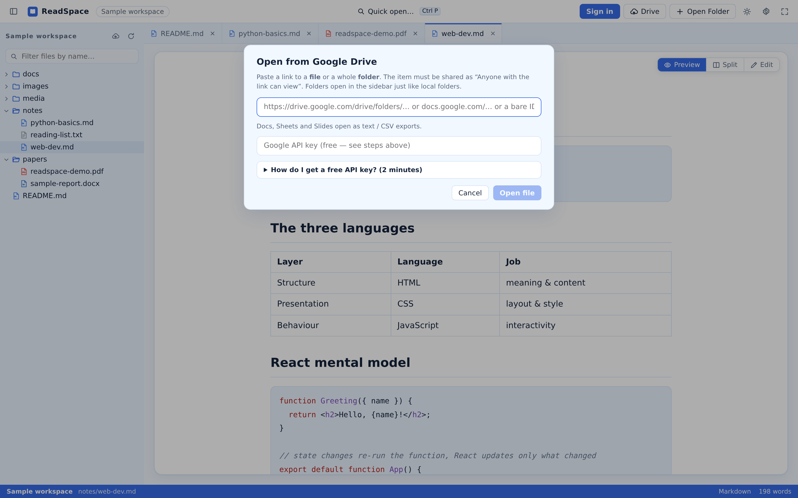
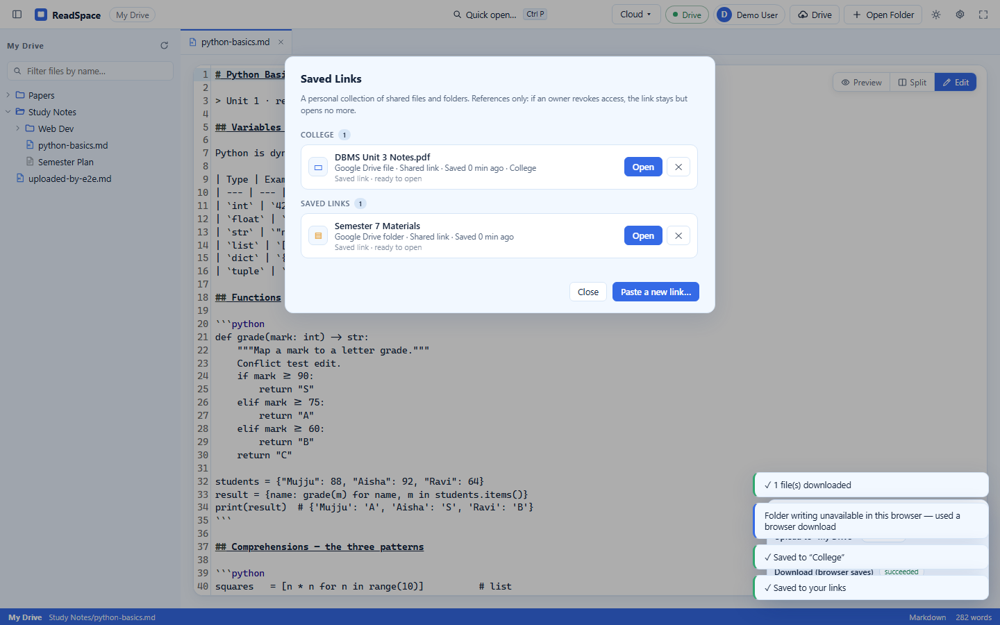
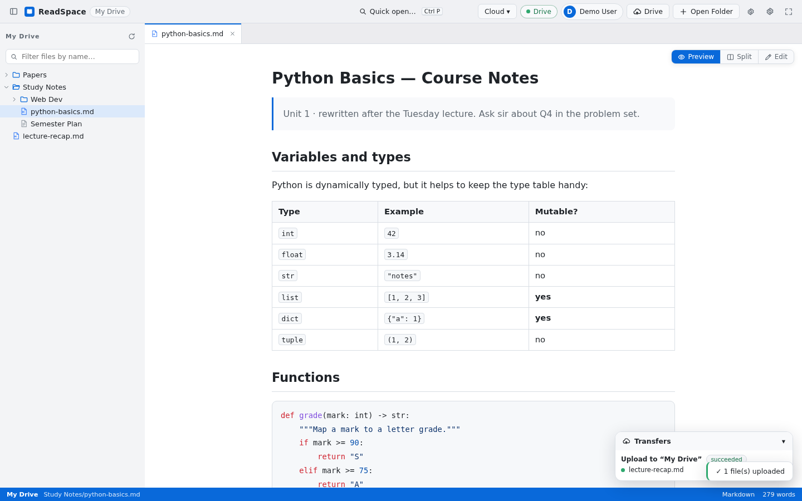
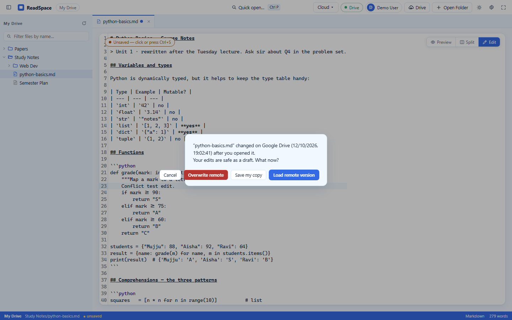

# 5. Cloud, Synchronization, and Data Architecture

ReadSpace bridges local file systems and remote cloud services through a modular, decoupled data architecture. This chapter details how identity, sessions, Google Drive integration, workspace state, and file transfers are implemented across client storage tiers and the backend.

---

## 5.1 The Four Distinct Cloud Operations

To prevent confusion between account identity, cloud storage access, and synchronization, ReadSpace separates cloud interactions into four distinct operational layers:

```text
┌───────────────────────────────────────────────────────────────────────────┐
│                           Layer 1: User Identity                          │
│   Registers or authenticates the user; issues an opaque 30-day session.   │
│   • Endpoints: /api/auth/register, /api/auth/login, /api/auth/me          │
└─────────────────────────────────────┬─────────────────────────────────────┘
                                      │
┌─────────────────────────────────────▼─────────────────────────────────────┐
│                    Layer 2: Cloud Storage Authorization                   │
│   Explicit OAuth 2.0 grant allowing ReadSpace to proxy Google Drive files.│
│   • Endpoints: /api/auth/google/start, /api/drive/status, /api/drive/*    │
└─────────────────────────────────────┬─────────────────────────────────────┘
                                      │
┌─────────────────────────────────────▼─────────────────────────────────────┐
│                    Layer 3: Workspace Session Metadata                    │
│   Debounced sync of non-binary UI state: open tabs, active file, layout.  │
│   • Endpoints: /api/workspaces, /api/workspaces/sync                      │
└─────────────────────────────────────┬─────────────────────────────────────┘
                                      │
┌─────────────────────────────────────▼─────────────────────────────────────┐
│                      Layer 4: Explicit Cloud Transfer                     │
│   User-reviewed batch uploads and downloads between local disk and Drive. │
│   • Endpoints: /api/transfers/scan, /api/transfers                        │
└───────────────────────────────────────────────────────────────────────────┘
```

| Operational Layer | What the Code Actually Executes | What NOT to Assume |
|---|---|---|
| **1. Account Identity** | Authenticates user via email/password, Google Sign-In, or WebAuthn; creates an authenticated session record. | Logging in does **not** grant access to Google Drive files or upload local files. |
| **2. Drive Authorization** | Performs a dedicated OAuth consent flow requesting `drive.file` / `drive.readonly` scopes; stores encrypted refresh tokens. | Authorizing Drive does **not** automatically upload your entire hard drive or continuously mirror local folders. |
| **3. Session Sync** | Sends debounced JSON metadata describing active workspace layout, tab order, and scroll offsets. | Session sync does **not** copy binary file contents across devices. |
| **4. Cloud Transfer** | Scans local files, compares them against Drive metadata, and performs user-approved chunked uploads or downloads. | A scan does **not** perform transfers automatically; same-size matches are **not** byte-level hash checks. |

---

## 5.2 Identity, Authorization, and Session Security

ReadSpace implements defense-in-depth security principles across authentication, token storage, and session lifecycle management:

### Session Tokens and Transport
- **Web Clients:** Use an opaque session identifier stored in an `HttpOnly`, `SameSite=Lax` browser cookie named `rs_session`. When HTTPS transport is detected, the `Secure` flag is enforced automatically.
- **Mobile Clients:** Transmit session tokens via the `x-session-id` header or standard `Authorization: Bearer <session-id>` HTTP headers, persisted locally in `AsyncStorage`.
- **Session Duration:** Sessions expire automatically after 30 days of inactivity on the backend.

### Password Security
User passwords submitted during registration or password updates are hashed on the server using the **Scrypt** key derivation function (`scryptSync`) with high memory cost parameters and a cryptographically secure 16-byte random salt. Plaintext passwords are never stored or logged.

### Cloud Token Encryption at Rest
Google OAuth refresh tokens permit long-term access to a user's cloud documents. ReadSpace safeguards these credentials using **AES-256-GCM authenticated encryption**:
- Encryption keys are derived from the server environment variable `TOKEN_ENCRYPTION_KEY`.
- Each encrypted token record contains a version header, a unique 12-byte initialization vector (IV), the encrypted ciphertext, and a 16-byte GCM authentication tag.
- If `TOKEN_ENCRYPTION_KEY` is not configured, the backend logs a critical security warning and falls back to a development-only mock key. **Production deployments must supply a strong 256-bit secret key.**

---

## 5.3 Google Drive Workspace and File Operations

Once Google Drive is authorized, ReadSpace mounts remote Drive folders as virtual workspaces within the app:



### Folder Hierarchy and Content Streaming:
- **Directory Traversal:** ReadSpace queries `/api/drive/files` with query parameters filtering by parent folder ID, returning directory hierarchies and file metadata.
- **Document Streaming:** Clicking a file invokes `/api/drive/files/:id/content`. Binary files (PDFs, images) are streamed directly to the browser.
- **Google Docs / Sheets / Slides Export:** Proprietary Google Workspace formats do not contain raw binary files. ReadSpace automatically requests exported representations:
  - Google Docs are exported as **Plain Text** (`text/plain`) or **Markdown**.
  - Google Sheets are exported as **CSV** (`text/csv`).
  - Google Slides are exported as structured text presentations.

### Saved Links Architecture:
ReadSpace provides a specialized **Saved Links** system (`src/features/cloud/`) allowing users to store direct references to Google Drive documents without mounting entire folders:



- **Resource Keys:** ReadSpace parses complex Google Drive sharing URLs, extracting file IDs, folder IDs, and required Google `resourcekey` query parameters.
- **Metadata Tagging:** Saved links can be tagged into collections (e.g., `Research`, `Work`, `Personal`) and assigned custom display titles.
- **Reading Progress Tracking:** Reading progress and last-read timestamps for saved links are synchronized with the backend.

---

## 5.4 Scan, Comparison, and Upload Pipeline

Transferring documents from a local workspace to Google Drive follows an explicit, user-governed pipeline:



### Step-by-Step Upload Workflow:
1. **Target Destination Selection:** The user selects a destination folder in Google Drive (or allows ReadSpace to create a matching folder name).
2. **Local Workspace Manifest Scan:** The client traverses the local file tree, building a manifest of relative file paths, byte sizes, and last modified timestamps.
   > [!NOTE]
   > The client-side scanner limits manifests to a maximum of 1,000 files per run to avoid browser memory saturation during large repository scans.
3. **Server-Side Manifest Comparison:** The client transmits the manifest to `POST /api/transfers/scan`. The backend compares local items against remote Drive folder contents and classifies each file:
   - `likely_new`: The path does not exist in the remote Drive folder.
   - `same_candidate`: The file path exists in Drive and has an identical byte size.
   - `name_collision`: The file path exists in Drive but the byte size differs.
4. **User Review and Confirmation:** The UI presents the classified candidates. The user explicitly selects which files to transfer:
   - **Upload New Only:** Uploads solely `likely_new` items.
   - **Upload All:** Uploads both new files and collisions.
   - **Upload Selected:** Transfers only user-checked files.
5. **Batch Transfer Execution:** Files are uploaded concurrently via `POST /api/drive/files` with real-time transfer progress tracking displayed in the transfer panel.

---

## 5.5 Cloud Concurrency and Conflict Resolution

When editing a cloud-backed document directly in Google Drive, ReadSpace implements optimistic concurrency control to prevent users from accidentally overwriting colleagues' changes:

```text
User Opens Cloud File (captures remote modifiedTime: T1)
                     │
         User Edits Text in ReadSpace
                     │
        User Presses Ctrl+S to Save
                     │
                     ▼
Backend Checks Remote File modifiedTime
                     │
      ┌──────────────┴──────────────┐
      │                             │
   Matches T1                  Differs (Remote has changed: T2)
      │                             │
      ▼                             ▼
Save Succeeds             Save Blocked:
                          ReadSpace Displays Conflict Dialog
                                    │
         ┌──────────────────────────┼──────────────────────────┐
         ▼                          ▼                          ▼
[ Overwrite Remote ]       [ Save My Copy ]          [ Load Remote Version ]
Forces local text onto     Creates a separate        Discards local edits;
remote file (T1 -> T3).    timestamped copy          reloads latest remote
                           in Google Drive.          content (T2).
```

When a conflict occurs, the **Cloud Conflict Dialog** prompts the user with three safe options:



1. **Overwrite Remote:** Disregards the remote modification and updates the Drive file with your local content.
2. **Save My Copy:** Uploads your version as a new, timestamped file (e.g., `Notes (Conflict 2026-11-03).md`), preserving both your work and the remote changes.
3. **Load Remote Version:** Discards your unsaved edits and refreshes the editor with the latest content from Google Drive.

---

## 5.6 Data Residency and Persistence Matrix

The following table summarizes where all user data, configuration, documents, and credentials reside:

| Data Category | Storage Tier | Specific Storage Keys & Tables | Persistence Lifetime |
|---|---|---|---|
| **Theme & UI Preferences** | Browser `localStorage` / Mobile `AsyncStorage` | `readspace-settings`, `readspace_theme` | Persistent until browser or app cache is cleared. |
| **Open Tabs & Active File** | Browser `localStorage` | `readspace-tabs` | Persistent per workspace across browser sessions. |
| **File System Directory Handles** | Browser `IndexedDB` (`readspace_fsa`) | `handles` store: directory and file handles | Persists across sessions; requires one-click permission re-verification on reload. |
| **In-Flight Text Drafts** | Browser `IndexedDB` (`readspace_drafts`) | `drafts` store: file path, timestamp, unsaved content | Retained until explicitly saved or cleared by user. |
| **Cached File Blobs** | Browser `IndexedDB` / Mobile Cache Directory | `readspace_blobs`, `file://.../cache/` | Ephemeral; purged when device storage limits are reached or cache is cleared. |
| **User Account Credentials** | Backend Database (MongoDB or JSON fallback) | `users` collection: email, salted Scrypt hash, passkey credentials | Permanent until account is deleted. |
| **Encrypted Google Tokens** | Backend Database (MongoDB or JSON fallback) | `connections` collection: encrypted refresh tokens, expiry | Permanent until user clicks **Disconnect Drive**. |
| **Workspace Sessions** | Backend Database (MongoDB or JSON fallback) | `workspaces`, `workspaceSessions` collections | Persists with account; synchronizes across authorized clients. |
| **Saved Links Repository** | Backend Database (MongoDB or JSON fallback) | `savedLinks` collection: URL, resource key, tags, title | Persists with account; accessible on Web and Mobile. |
| **Transfer Job Records** | Backend Database (MongoDB or JSON fallback) | `transfers` collection: job status, progress, item lists | Ephemeral tracking; retained for 7 days. |

---

## 5.7 Offline Availability and Data Safety Rules

ReadSpace is engineered to maximize reading availability when internet access is absent:

1. **Offline Core Engines:**
   - The Web app registers static assets through service workers, allowing the app shell, Markdown parser, and PDF viewer to run offline.
   - The Mobile companion bundles offline document-rendering engines directly within the native application package (`src/vendor/offlineVendors.ts`).
2. **Local Document Independence:**
   - Local folders opened via Chromium File System Access or Android SAF require zero network connectivity. Reading, filtering, and editing operate entirely locally.
3. **Safe Cache Purging Principles:**
   - Clearing local cache or browser storage deletes temporary offline metadata.
   - **It does not delete your physical files on disk or remove documents stored in Google Drive.**
   - Disconnecting Google Drive removes encrypted tokens from the ReadSpace database; it never deletes your Google account or Drive documents.

---

**Codebase References:**
- Cloud Feature Controller: [src/features/cloud/](file:///d:/AVTIVE%20PROJ/readspace/src/features/cloud/)
- Google Drive Provider: [src/services/fs/cloud.ts](file:///d:/AVTIVE%20PROJ/readspace/src/services/fs/cloud.ts)
- Saved Links Provider: [src/services/fs/cloudlink.ts](file:///d:/AVTIVE%20PROJ/readspace/src/services/fs/cloudlink.ts)
- Backend Router: [server/lib/routes.mjs](file:///d:/AVTIVE%20PROJ/readspace/server/lib/routes.mjs)
- Session Controller: [server/lib/session.mjs](file:///d:/AVTIVE%20PROJ/readspace/server/lib/session.mjs)
- Crypto Token Engine: [server/lib/crypto.mjs](file:///d:/AVTIVE%20PROJ/readspace/server/lib/crypto.mjs)
- Database Adapter: [server/lib/db.mjs](file:///d:/AVTIVE%20PROJ/readspace/server/lib/db.mjs)
