# 6. End-to-End User Walkthroughs

This chapter provides step-by-step user journeys covering core reading workflows, document editing, cloud integration, mobile companion operations, and error recovery.

> [!NOTE]
> **Verification Status Indicator:**
> - `[Observed Live]` — Verified directly on the deployed web instance.
> - `[Code-Based]` — Implemented in source code; verified structurally via static type-checking.
> - `[Target-Specific]` — Requires target device builds or authenticated external Google accounts.

---

## W01 — Explore ReadSpace Without an Account `[Observed Live]`

**Objective:** Experience the reading workspace immediately using the built-in sample project without signing in or selecting local files.

1. Open your browser and navigate to the ReadSpace web application.
2. On the home dashboard, locate the **Try the sample workspace** card and click it.

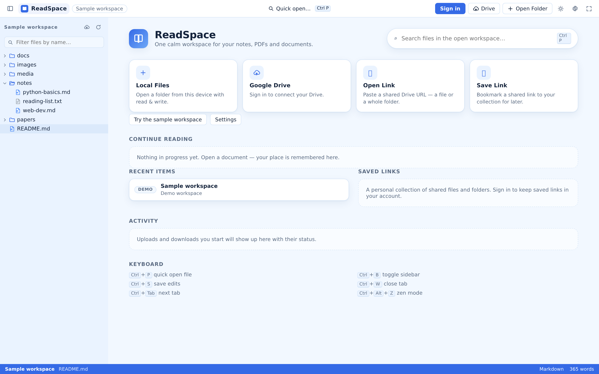

3. The view smoothly transitions to the workspace workbench:
   - The left sidebar displays the sample folder tree (`papers/`, `guides/`, and `README.md`).
   - Click **Open sample README** in the main canvas or select `README.md` from the tree.
4. The Markdown reader opens in a new tab, displaying rendered headers, formatted lists, syntax-highlighted code blocks, and embedded diagrams.
5. In the explorer, expand the `papers/` folder and click `readspace-demo.pdf`.
6. Return to the home screen at any time by clicking the ReadSpace logo in the top toolbar.

**Expected Outcome:** Full exploration of the workspace interface, tab management, and document renderers without any setup friction.

---

## W02 — Mount and Read a Local Folder on Web `[Code-Based]`

**Objective:** Transform an existing local folder on your computer into an interactive reading library.

1. From the home screen, click **Local Files**, or click **Open Folder** in the top navigation bar.
2. The browser opens the native operating system directory picker.
3. Navigate to a local folder containing reading materials (e.g., `Documents/ReadingList`) and click **Select Folder**.
4. When prompted by your browser:
   - *Chromium (Chrome/Edge/Brave):* Click **View Files** (or **Edit Files** for write permissions).
   - *Firefox / Safari:* Confirm folder upload to create an in-memory directory snapshot.
5. The workspace explorer immediately populates with your folder hierarchy.
6. Click any document in the tree to open it in a reader tab.

**Expected Outcome:** Instant local folder browsing with automatic exclusion of developer clutter (`.git`, `node_modules`).

---

## W03 — Read and Navigate PDF Documents `[Observed Live]`

**Objective:** Read multi-page academic papers, manuals, or ebooks with high-fidelity canvas rendering.

1. In the workspace explorer, click any `.pdf` document (e.g., `papers/readspace-demo.pdf`).
2. The PDF Viewer initializes, presenting the document with fluid page rendering:

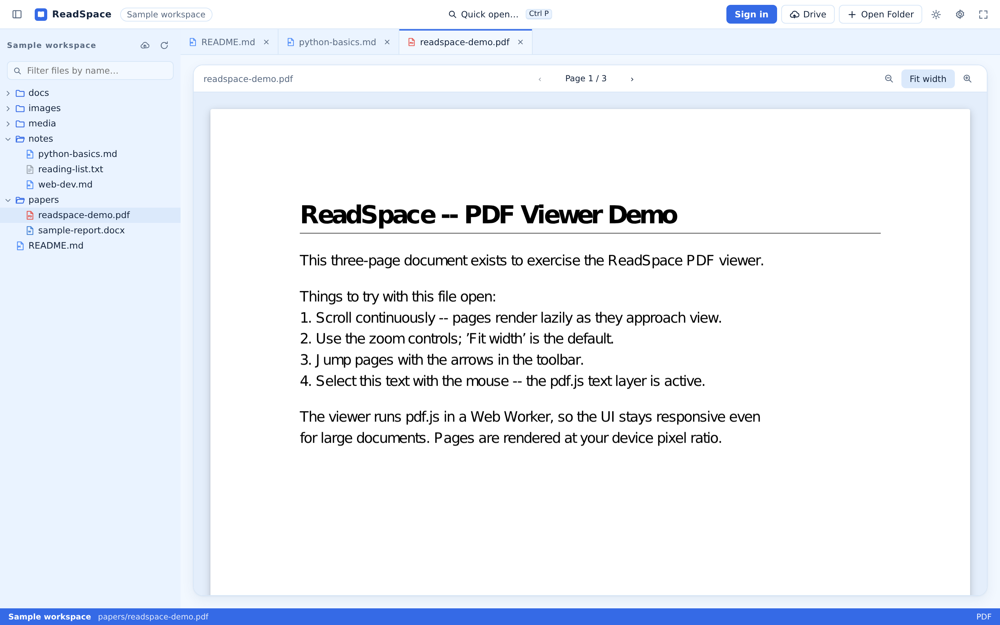

3. Use the top viewer controls to navigate:
   - Click the **Next Page (`>`)** or **Previous Page (`<`)** buttons.
   - Click the page number input box, type `4`, and press `Enter` to jump directly to page 4.
   - Click **Zoom In (`+`)** or **Zoom Out (`-`)** to adjust text magnification.
   - Click **Fit to Width** to maximize document width to your reading canvas.
4. Scroll smoothly through pages using your mouse wheel, trackpad, or keyboard arrow keys.

**Expected Outcome:** Fast, responsive PDF reading with crisp typography and intuitive navigation.

---

## W04 — Edit Markdown in Live Split-View Mode `[Code-Based]`

**Objective:** Edit notes, documentation, or study guides side-by-side with real-time rendered preview.

1. Open a Markdown (`.md`) file from a writable local folder or Google Drive workspace.
2. In the viewer toolbar, click **Split** to enter side-by-side editing mode.

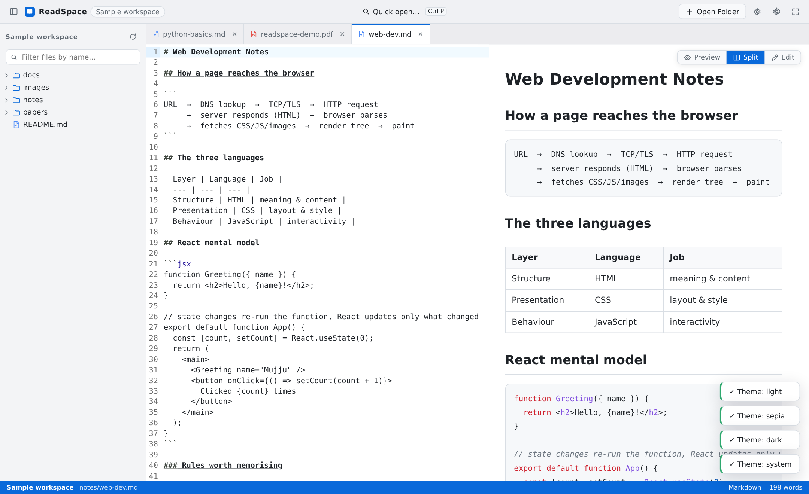

3. The canvas divides into two synchronized panes:
   - **Left Pane:** Text editor with syntax highlighting, line numbers, and word wrap.
   - **Right Pane:** Live rendered preview updating automatically as you type.
4. Type new headings, bullet points, or task lists (`- [x] Done`) in the editor pane.
5. Press `Ctrl+S` (or `Cmd+S` on macOS) to save your changes.
   - On Chromium browsers with write permission, changes are written directly to your local file on disk.
   - In read-only environments, ReadSpace triggers an automated download of your updated file.

**Expected Outcome:** Seamless document editing with instant visual feedback and robust disk persistence.

---

## W05 — Customize Appearance Themes and Typography `[Observed Live]`

**Objective:** Tailor the reading environment to match your lighting conditions and personal aesthetic preferences.

1. Click the **Theme Switcher** icon in the top toolbar to cycle through themes:
   - **Ice Blue:** Modern, focused slate-blue workspace palette.
   - **Light:** Clean, classic paper-white reading mode.
   - **Dark:** Deep charcoal palette designed for night reading.
   - **Sepia:** Warm, bookish parchment tones that reduce eye strain.

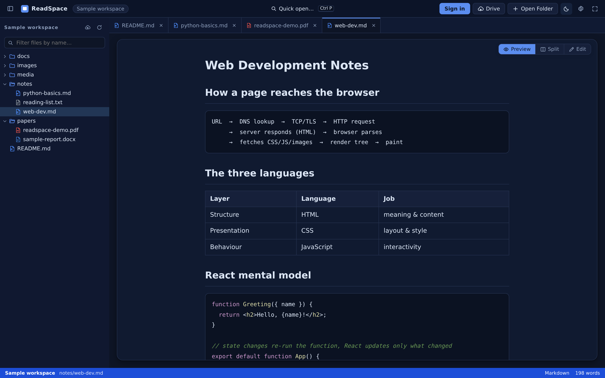

2. Click the **Settings** icon to open the Reader Settings panel:
   - Switch font family from **Sans-Serif** to **Serif** or **Monospace**.
   - Drag the **Font Size** slider to increase or decrease text scale.
   - Adjust **Line Height** to create breathing room between paragraphs.
   - Adjust **Content Width** to prevent overly wide text lines on ultrawide monitors.
3. Press `Ctrl+Alt+Z` to enter **Zen Mode**, hiding all peripheral toolbars for an unobstructed reading session.

**Expected Outcome:** Highly personalized reading comfort that persists automatically across browser sessions.

---

## W06 — Sign In and Authorize Google Drive `[Target-Specific]`

**Objective:** Connect your ReadSpace account to Google Drive to enable cloud folder reading and document synchronization.

1. In the top navigation bar, click **Sign In**.
2. Authenticate using your email/password, Google identity, or WebAuthn passkey.
3. Open the Google Drive dialog by clicking **Google Drive** on the home screen:

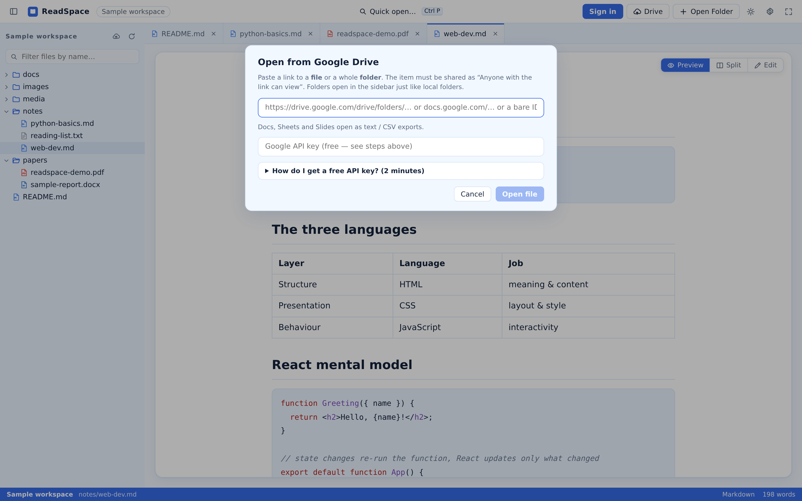

4. Click **Connect Google Drive**.
5. When redirected to Google's OAuth consent screen, review the requested scopes (`drive.file` and `drive.readonly`) and click **Allow**.
6. Upon returning to ReadSpace, the Drive status indicator in the top toolbar displays a green **Connected** badge.

**Expected Outcome:** Secure cloud connectivity established without compromising your private credentials.

---

## W07 — Browse an Authenticated Drive Workspace `[Target-Specific]`

**Objective:** Mount a remote Google Drive folder as your active reading workspace.

1. Ensure Google Drive is connected (W06).
2. Click **Google Drive** in the toolbar and select **Browse Google Drive**.
3. Browse your cloud folder hierarchy and select your target reading folder (e.g., `Class Materials` or `Research Papers`).
4. Click **Select Folder**. ReadSpace mounts the cloud directory into the workspace explorer.
5. Click any cloud-stored PDF, Markdown document, or Google Doc to stream and read it instantly.

**Expected Outcome:** Full remote directory traversal with on-demand document streaming.

---

## W08 — Save and Organize Cloud Document Links `[Code-Based]`

**Objective:** Curate a collection of direct references to Google Drive documents without mounting entire folders.

1. Click **Save Link** on the home dashboard or in the cloud menu:

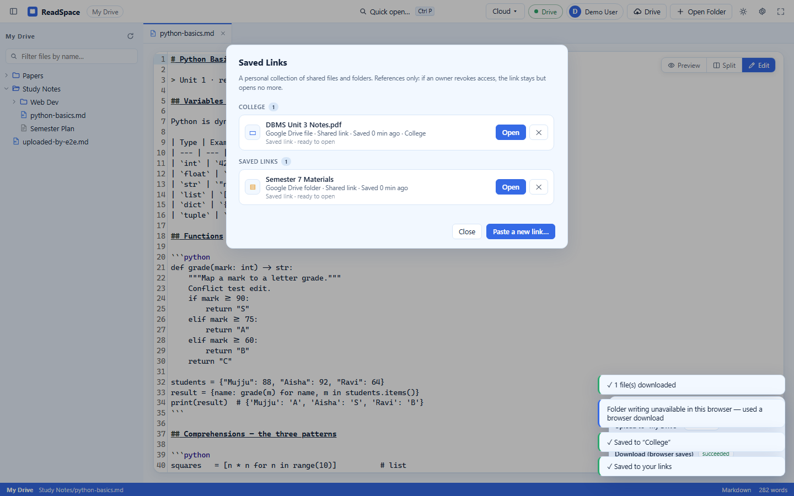

2. Paste a Google Drive sharing URL or file ID into the input field.
3. ReadSpace automatically parses the URL, extracting the file identifier and required `resourcekey` parameters.
4. Enter a custom display title (e.g., *Distributed Systems Paper*) and assign a collection tag (e.g., *CS 401*).
5. Click **Save Link**. The reference is added to your permanent cloud bookmarks.
6. Revisit your saved links at any time from the home dashboard or the mobile companion app.

**Expected Outcome:** Instant, organized access to disparate cloud documents across all devices.

---

## W09 — Scan and Upload Local Files to Google Drive `[Code-Based]`

**Objective:** Deliberately back up or transfer selected local workspace documents to a designated Google Drive folder.

1. Mount a local workspace folder (W02) and ensure Google Drive is connected (W06).
2. Click **Transfer / Sync** in the cloud toolbar to open the transfer panel:

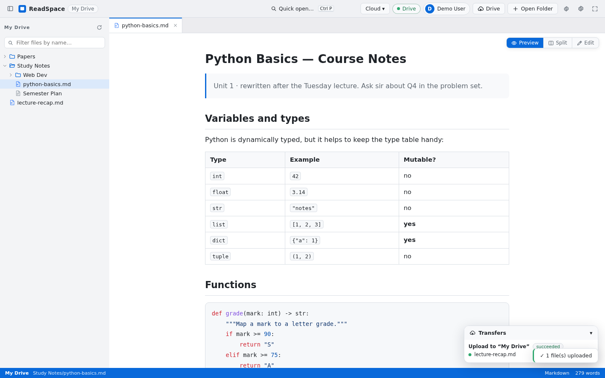

3. Select your target destination folder in Google Drive.
4. Click **Scan Local Files**. ReadSpace scans up to 1,000 local files and sends the manifest to the backend comparison engine.
5. Review the classified results:
   - **New Files (`likely_new`):** Files present locally but missing in Drive.
   - **Identical Files (`same_candidate`):** Files matching remote paths and byte sizes.
   - **Collisions (`name_collision`):** Files with matching paths but different sizes.
6. Select the files you want to transfer and click **Upload Selected** (or **Upload New Only**).
7. Monitor real-time upload progress in the transfer queue.

**Expected Outcome:** Precise, user-governed file backup to Google Drive with zero accidental overwrites.

---

## W10 — Download Cloud Files to Local Storage `[Code-Based]`

**Objective:** Download documents or folders from Google Drive to your local hard drive for offline reading.

1. Open a Google Drive workspace (W07).
2. Right-click any file or folder in the explorer and select **Download**.
3. In browsers supporting the File System Access API, select a local destination directory.
4. ReadSpace streams the files from Google Drive and writes them directly to your local folder.
5. In standard browsers, ReadSpace packages the files and triggers an automated browser download.

**Expected Outcome:** Local copies acquired safely for offline study and preservation.

---

## W11 — Resolve a Remote Edit Conflict `[Code-Based]`

**Objective:** Safely resolve concurrency conflicts when a cloud file is modified by another user or device while you are editing.

1. Open an editable Markdown document from a Google Drive workspace.
2. Make text edits in the editor.
3. If the remote file is modified externally before you save, pressing `Ctrl+S` triggers the **Cloud Conflict Dialog**:

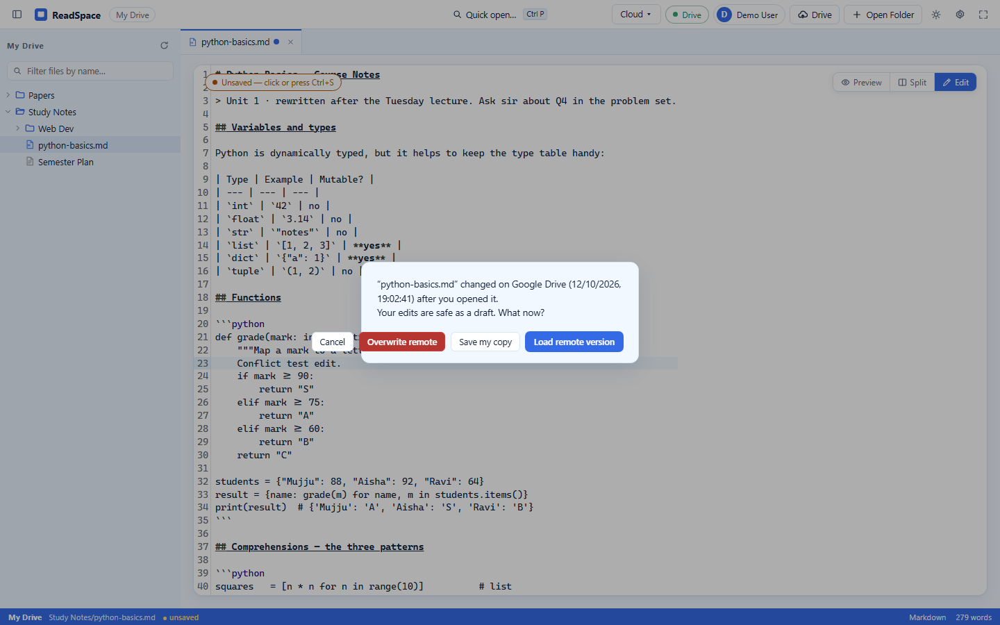

4. Choose your desired resolution path:
   - **Overwrite Remote:** Pushes your local text to Google Drive, updating the file.
   - **Save My Copy:** Saves your edits as a separate timestamped file (e.g., `Notes (Conflict 2026-11-03).md`), preserving both versions.
   - **Load Remote Version:** Discards your local unsaved edits and pulls the latest remote content.

**Expected Outcome:** Conscious, data-safe conflict resolution preventing silent data loss.

---

## W12 — Open Local Documents on Mobile Companion `[Target-Specific]`

**Objective:** Open and read documents stored on your mobile phone or tablet.

1. Launch the ReadSpace Mobile Companion app.
2. Tap the **Library** tab at the bottom of the screen:

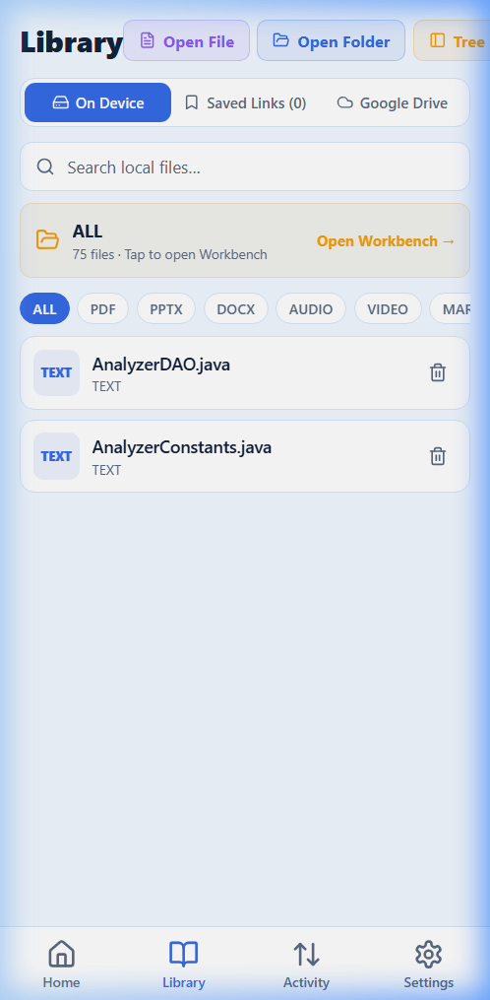

3. Ensure the **On Device** source tab is selected.
4. Tap **Open File** to invoke the native iOS or Android document picker.
5. Select your document (PDF, Markdown, DOCX, text).
6. The file is copied to the app's offline cache and opens immediately in the mobile Reader.

**Expected Outcome:** Touch-optimized mobile document reading with fast local file loading.

---

## W13 — Navigate Workspaces via Mobile Drawer `[Target-Specific]`

**Objective:** Seamlessly switch between files inside a multi-document folder on your mobile device.

1. Open a folder or multi-file collection on mobile (via Android SAF or iOS multi-picker).
2. Open any document to enter the Reader view.
3. Tap the **Folder Tree** icon in the reader header to slide out the workspace drawer:

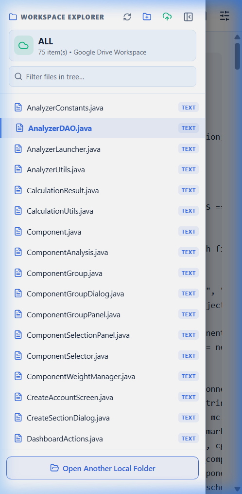

4. Browse the nested directory structure.
5. Tap any file to switch documents immediately without leaving the reading screen.
6. Tap outside the drawer to dismiss it and resume reading.

**Expected Outcome:** Fast, convenient intra-workspace navigation on smartphone screens.

---

## W14 — Access Google Drive on Mobile `[Target-Specific]`

**Objective:** Stream and read cloud-stored documents from Google Drive on your smartphone.

1. Open the mobile companion app and tap the **Library** tab.
2. Tap the **Google Drive** tab at the top of the screen:

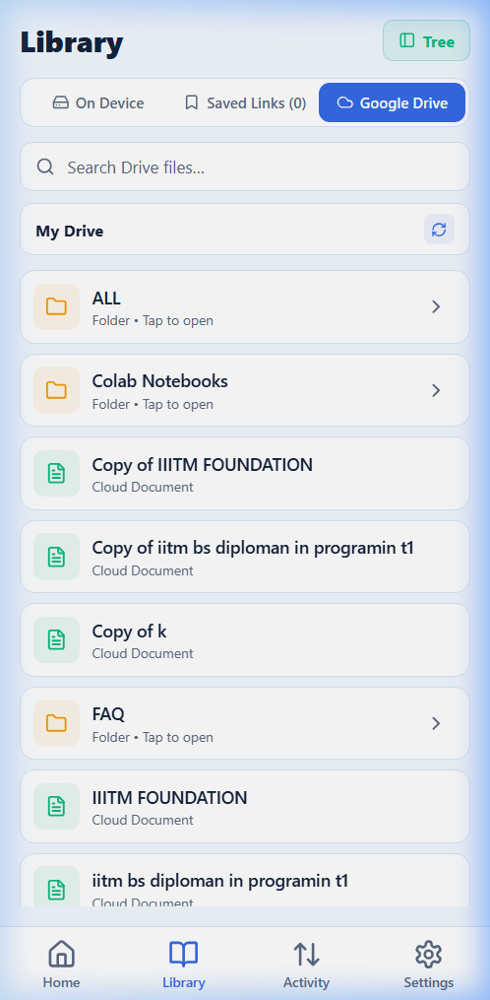

3. If prompted, sign in to your ReadSpace account to authorize Drive access.
4. Browse your cloud folders and tap any document.
5. The document streams from the backend API, caches locally, and opens in the mobile Reader.

**Expected Outcome:** Cloud document mobility with automatic local caching.

---

## W15 — Test Offline Reading Availability `[Target-Specific]`

**Objective:** Confirm that cached documents remain readable when internet connectivity is severed.

1. While online, open a target PDF or Markdown document from your Google Drive library on mobile or web.
2. Ensure the document renders completely so its assets are cached in local storage.
3. Disable your device's network connection (turn on Airplane Mode or disconnect Wi-Fi).
4. Close and reopen ReadSpace.
5. Navigate to your library and open the previously viewed document.
6. The document opens smoothly from local cache without displaying network timeout errors.

**Expected Outcome:** Reliable offline reading during commutes, flights, or remote fieldwork.

---

## W16 — Resume Reading Sessions Across Devices `[Target-Specific]`

**Objective:** Transition seamlessly from reading on your desktop workstation to reading on your mobile companion.

1. On your desktop browser, sign in to your ReadSpace account.
2. Open a shared document from Google Drive or Saved Links, read several pages, and pause.
3. ReadSpace debounces and sends your active reading metadata (document path, scroll percentage) to the backend.
4. Open the ReadSpace Mobile Companion app on your phone and sign in with the same account.
5. On the mobile Home screen, look at the **Continue Reading** card: it reflects the document and reading position from your desktop session.
6. Tap the card to resume reading exactly where you left off.

**Expected Outcome:** Coordinated cross-device continuity for cloud-backed reading workflows.

---

## W17 — Play Integrated Audio and Video Media `[Code-Based]`

**Objective:** Listen to recorded lectures or watch video demonstrations alongside your reading notes.

1. In the workspace explorer, locate and click an audio (`.mp3`, `.wav`, `.m4a`) or video (`.mp4`, `.webm`) file.
2. The specialized media viewer mounts inside the reading canvas.
3. Use the integrated HTML5 media controls to play, pause, seek along the scrubber bar, adjust volume, or change playback speed (0.75x to 2.0x).
4. On mobile devices with background audio enabled in Settings, audio playback continues smoothly even when switching tabs.

**Expected Outcome:** Native multimedia playback without needing external media player software.

---

## W18 — Manage Account Security and Purge Cache `[Code-Based]`

**Objective:** Audit account connections, configure privacy settings, and clean up temporary offline storage.

1. On mobile, navigate to the **Settings** tab:

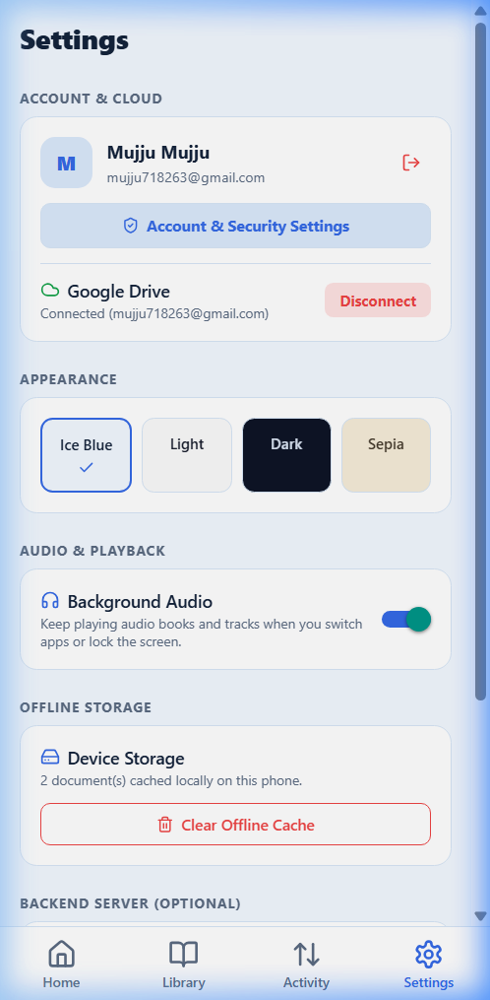

2. Inspect your account status and connected backend server URL.
3. To remove cloud credentials, tap **Disconnect Google Drive**. ReadSpace immediately revokes and purges your encrypted OAuth tokens from the backend.
4. To clean up local phone storage, scroll to **Storage & Cache** and tap **Clear Cache**.
5. Confirm the warning dialog to remove offline reading history and temporary caches.

**Expected Outcome:** Transparent, user-controlled privacy and storage management.

---

## W19 — Recover From Permissions or Network Errors `[Code-Based]`

**Objective:** Gracefully recover when browser folder permissions expire or network connectivity drops.

1. If your browser displays a *"Permission Expired"* notification upon reopening a local folder:
   - Click the **Verify Permission** button located in the file explorer header.
   - Click **Allow** in the native browser prompt to re-grant read/write access immediately.
2. If saving a file fails due to an external file lock or read-only provider:
   - ReadSpace automatically intercepts the failure and presents an emergency download prompt.
   - Click **Download Copy** to save your work safely to your local `Downloads` folder.
3. If an API request fails, check the backend status indicator in the toolbar to verify network connectivity.

**Expected Outcome:** Fail-safe data preservation preventing accidental work loss.

---

## W20 — Check and Apply Mobile App Updates `[Target-Specific]`

**Objective:** Keep your mobile companion app up to date with the latest features, security patches, and rendering engines.

1. Open the mobile companion app and tap the **Settings** tab.
2. Scroll to the **Updates** section and tap **Check for Updates**:

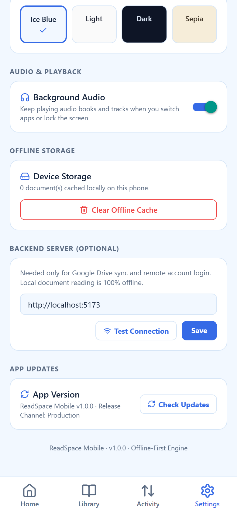

3. The update manager queries the distribution channel:
   - If an **Expo OTA Update** is available, ReadSpace downloads the new JavaScript bundle in the background and prompts: *"Update ready. Restart to apply?"* Tap **Restart** to apply immediately.
   - In standalone APK or non-OTA builds, the app queries GitHub Releases and provides a direct download link for the latest installer package.

**Expected Outcome:** Fast, friction-free application maintenance and feature delivery.

---

**Codebase References:**
- Web App Shell: [src/App.tsx](file:///d:/AVTIVE%20PROJ/readspace/src/App.tsx)
- Viewer Host: [src/components/ViewerHost.tsx](file:///d:/AVTIVE%20PROJ/readspace/src/components/ViewerHost.tsx)
- Cloud Feature Controller: [src/features/cloud/](file:///d:/AVTIVE%20PROJ/readspace/src/features/cloud/)
- Mobile Navigation: [readspace_app/src/navigation/RootNavigator.tsx](file:///d:/AVTIVE%20PROJ/readspace/readspace_app/src/navigation/RootNavigator.tsx)
- Mobile Update Service: [readspace_app/src/services/update.ts](file:///d:/AVTIVE%20PROJ/readspace/readspace_app/src/services/update.ts)
