# 12. Visual Interface Gallery

This gallery provides an annotated visual tour of the ReadSpace platform across both the Web Application and the Mobile Companion. Each screen is documented with its user interface components, interactive controls, and underlying codebase sources.

---

## 12.1 Web Platform Interface Gallery

### 1. Web Home Dashboard
The primary launchpad for the desktop web experience, featuring quick-action entry points, active reading cards, and activity summaries.

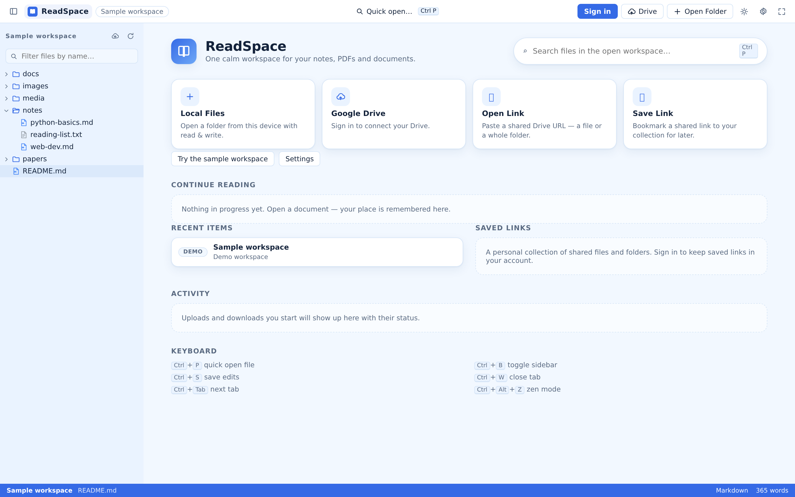

- **UI Component Breakdown:**
  - **Top Navigation Bar:** Brand logo, quick folder opening, Google Drive status indicator, theme switcher, reader settings, Zen mode toggle, and user profile avatar.
  - **Hero Header:** Greeting banner with quick-action cards (**Local Files**, **Google Drive**, **Open Link**, **Save Link**, and **Try the sample workspace**).
  - **Continue Reading Card:** Dynamic resume card displaying the last active document, its parent workspace path, and last-read timestamp.
  - **Recent Documents:** Chronological list of previously opened files across local and cloud workspaces.
  - **Activity & Keyboard Hints:** Footer summary displaying recent sync history and primary keyboard shortcuts (`Ctrl+P`, `Ctrl+B`, `Ctrl+S`, `Ctrl+Alt+Z`).
- **Codebase Source:** `src/components/viewers/Welcome.tsx`, `src/App.tsx`.

---

### 2. Web Reader Workbench
The unified document workbench with the hierarchical workspace file explorer expanded on the left and active Markdown reader loaded on the right.

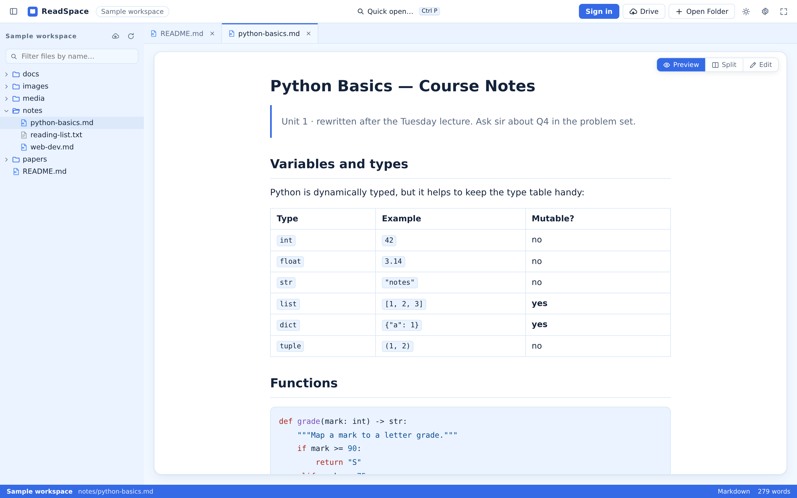

- **UI Component Breakdown:**
  - **Workspace File Explorer:** Collapsible tree view with real-time fuzzy filtering, directory expand/collapse carets, and automated exclusion of developer artifacts (`.git`, `node_modules`).
  - **Multi-Tab Document Bar:** Persistent tabs with active selection styling, close buttons (`x`), dirty edit indicators, and tab reordering support.
  - **Document Canvas:** Formatted Markdown renderer showing typography, headers, bold/italic text, lists, and syntax-highlighted code blocks.
  - **Status Footer:** Displays active workspace path, document format badge, file size, and line count.
- **Codebase Source:** `src/components/Explorer.tsx`, `src/components/TabBar.tsx`, `src/components/viewers/MarkdownViewer.tsx`.

---

### 3. Web PDF Viewer
Mozilla `pdf.js` integration providing high-fidelity canvas rendering for academic papers, ebooks, and manuals.

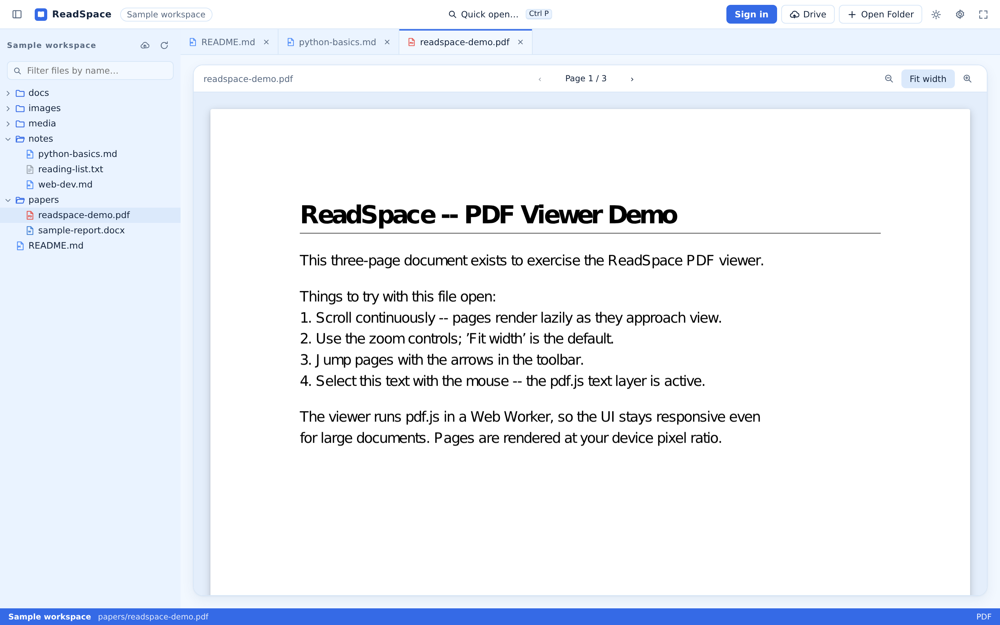

- **UI Component Breakdown:**
  - **Viewer Toolbar:** Document title, format badge, previous page (`<`), next page (`>`), page number input jump box, total page count, zoom out (`-`), zoom in (`+`), and **Fit to Width** toggle.
  - **Continuous Scroll Canvas:** High-DPI canvas rendering multi-page documents with smooth trackpad and mouse wheel scrolling.
  - **Text Selection Layer:** Enables native text selection, copying, and search within rendered PDF pages.
- **Codebase Source:** `src/components/viewers/PdfViewer.tsx`.

---

### 4. Web Live Split-View Text Editor
The side-by-side editing canvas allowing real-time Markdown editing on the left with instant rendered preview updates on the right.

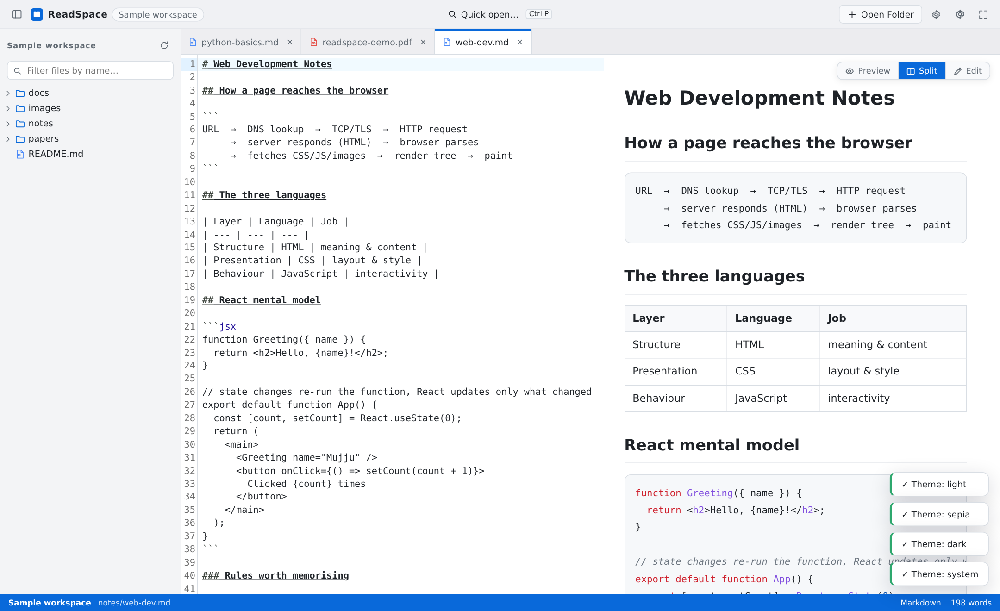

- **UI Component Breakdown:**
  - **Mode Selector:** Toggle buttons in the viewer toolbar switching between **Preview**, **Split**, and **Edit** views.
  - **Editor Pane (Left):** Monospace text editor with line numbers, code ligatures, syntax highlighting, and auto-indentation.
  - **Preview Pane (Right):** Live HTML/Markdown renderer synchronizing continuously with editor keystrokes.
  - **Dirty Buffer Indicator:** Visual dot on the document tab signaling unsaved in-memory changes.
- **Codebase Source:** `src/components/ViewerHost.tsx`, `src/stores/tabs.ts`.

---

### 5. Web Multi-Tab Buffer Management
Illustration of the tabbed document buffer system tracking multiple open files across different formats.

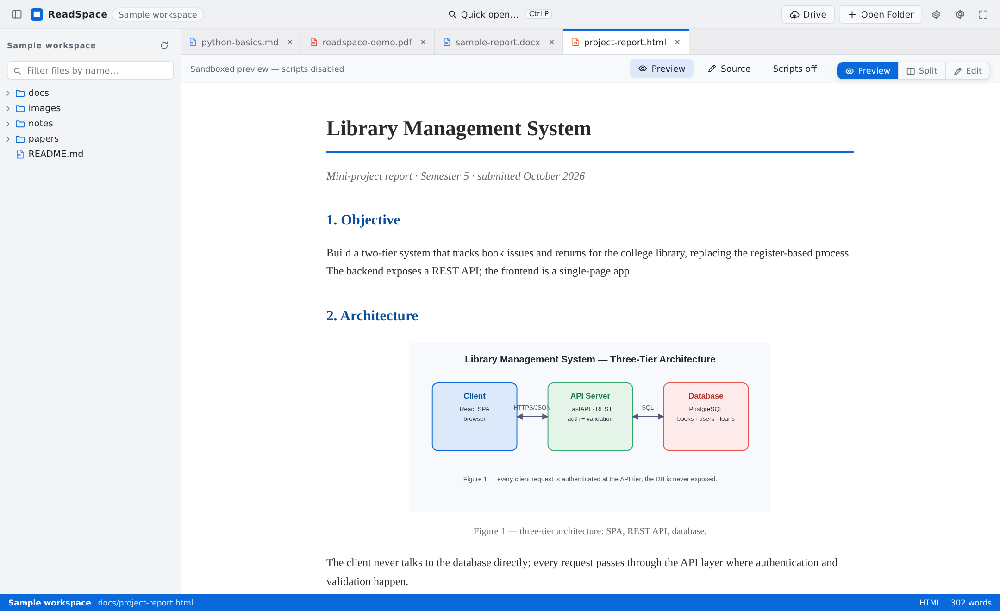

- **UI Component Breakdown:**
  - **Horizontal Tab Bar:** Dynamic tab list showing open Markdown files, PDFs, and code documents.
  - **Active Tab Highlight:** High-contrast tab underline and background distinguishing the currently viewed buffer.
  - **Tab Close Actions:** Individual close triggers on hover; prompts for confirmation if the file contains unsaved edits.
- **Codebase Source:** `src/components/TabBar.tsx`.

---

### 6. Web Dark Theme Palette
The low-light reading environment engineered to eliminate ocular fatigue during evening reading sessions.

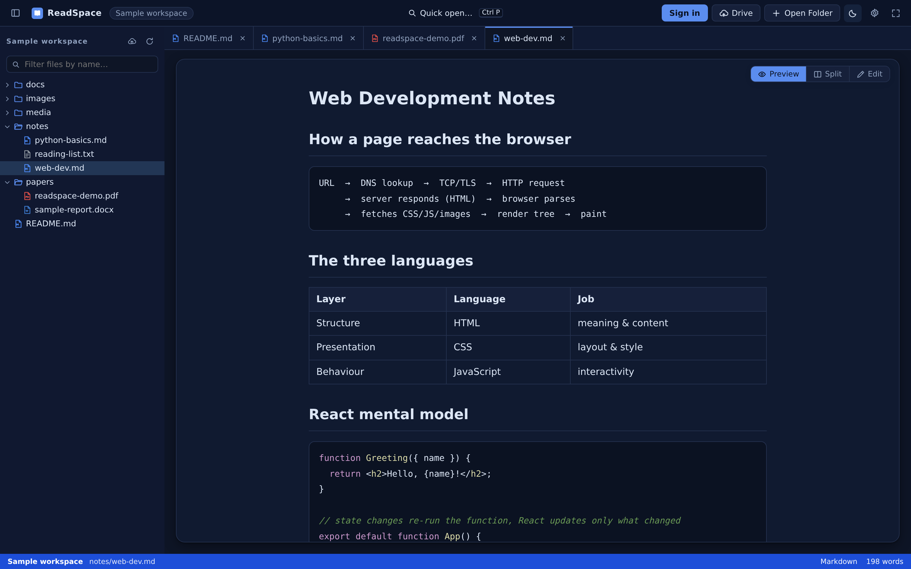

- **UI Component Breakdown:**
  - **Color Palette:** Deep obsidian background (`#0b1320`) paired with cool silver-gray typography and muted slate borders.
  - **High-Contrast Syntax Highlighting:** Optimized dark code block themes providing crystal-clear token visibility.
- **Codebase Source:** `src/stores/settings.ts`, `tailwind.config.js`.

---

### 7. Web Sepia Theme Palette
Warm, paper-like parchment tones mimicking physical book pages, ideal for literature and long-form articles.

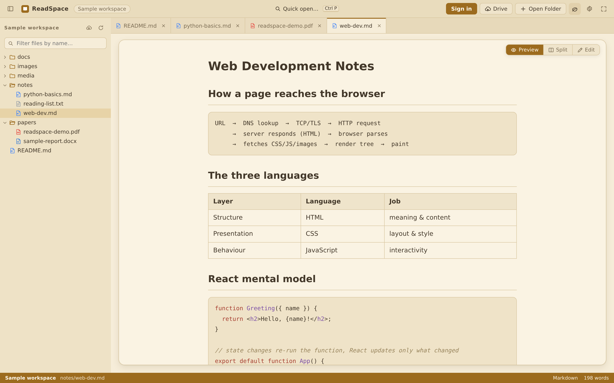

- **UI Component Breakdown:**
  - **Color Palette:** Warm cream-amber background (`#f4ecd8`) paired with deep charcoal-brown text.
  - **Typography:** Pairs with serif font settings to create a natural, bookish reading experience.
- **Codebase Source:** `src/stores/settings.ts`.

---

### 8. Web Google Drive Connection Modal
The cloud authorization dialog managing Google OAuth 2.0 integration and cloud folder selection.

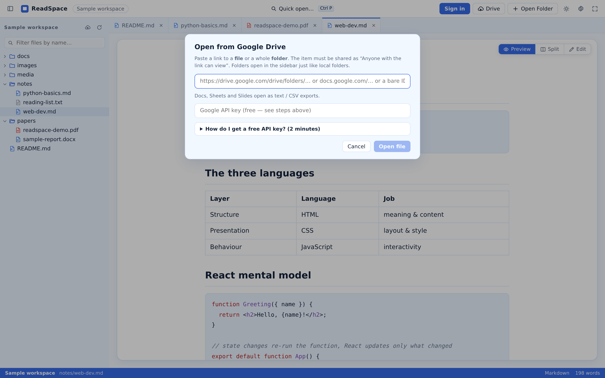

- **UI Component Breakdown:**
  - **Connection Status Card:** Displays active Google account email, connection state, and disconnect action.
  - **Folder Browser:** Hierarchical tree for selecting remote Google Drive directories to mount as workspaces.
  - **OAuth Action Buttons:** One-click **Connect Google Drive** button initiating secure OAuth 2.0 consent flow.
- **Codebase Source:** `src/features/cloud/`, `server/lib/routes.mjs`.

---

### 9. Web Saved Links Explorer
The cloud reference repository allowing users to organize and revisit individual Google Drive links without mounting full folders.

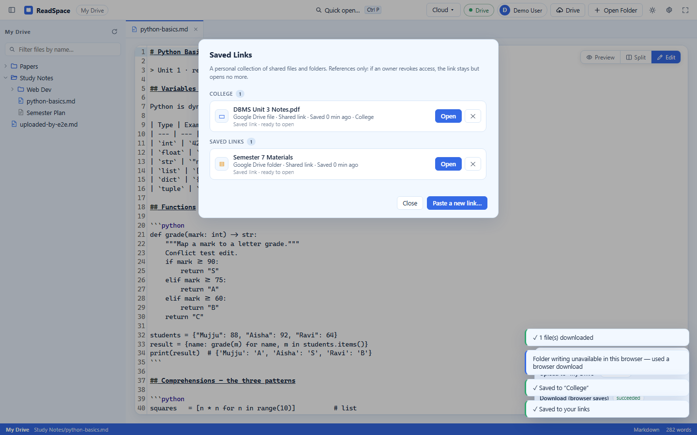

- **UI Component Breakdown:**
  - **Link Submission Form:** URL input field with automated Google Drive file ID and `resourcekey` extraction.
  - **Collection Filter:** Tag-based filtering (e.g., *Research*, *Work*, *Finance*).
  - **Saved Item List:** Displays custom titles, remote file types, collection tags, and reading progress indicators.
- **Codebase Source:** `src/features/cloud/`, `src/services/fs/cloudlink.ts`.

---

### 10. Web Cloud Transfer & Synchronization Panel
The explicit, user-governed file transfer interface for uploading local workspace documents to Google Drive.

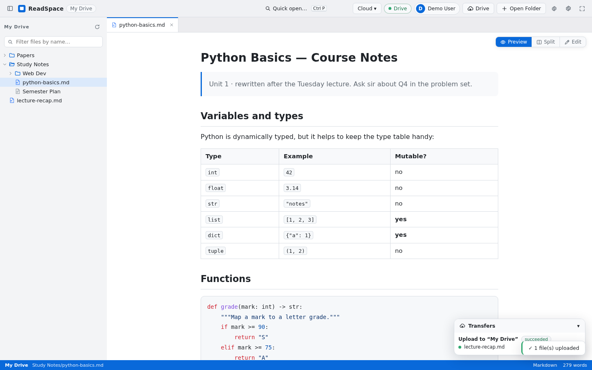

- **UI Component Breakdown:**
  - **Target Folder Selector:** Chooses remote Google Drive destination.
  - **Candidate Classification Table:** Categorizes scanned files into `likely_new` (green), `same_candidate` (neutral), and `name_collision` (yellow).
  - **Batch Action Buttons:** **Upload New Only**, **Upload All**, and **Upload Selected**.
  - **Progress Monitor:** Real-time progress bar tracking byte transfers and job completion.
- **Codebase Source:** `src/features/cloud/autoSync.ts`, `src/stores/transfer.ts`.

---

### 11. Web Cloud Conflict Resolution Dialog
The optimistic concurrency dialog safeguarding against accidental remote file overwrites.

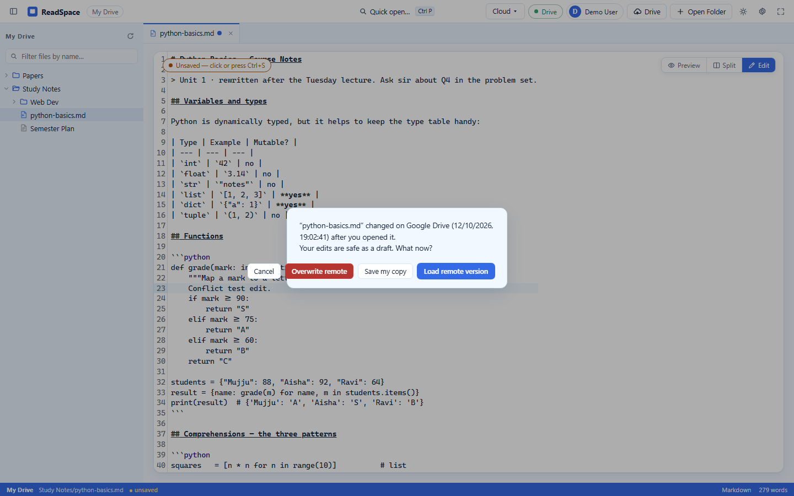

- **UI Component Breakdown:**
  - **Conflict Warning Banner:** Alerts the user that the remote Google Drive document was modified externally.
  - **Three Resolution Pathways:**
    1. **Overwrite Remote:** Pushes local edits to Drive.
    2. **Save My Copy:** Saves edits as a separate timestamped duplicate file.
    3. **Load Remote Version:** Discards local edits and refreshes with the latest remote version.
- **Codebase Source:** `src/components/ViewerHost.tsx`.

---

## 12.2 Mobile Companion Interface Gallery

### 12. Mobile Companion Home Screen
The primary dashboard of the React Native mobile application, featuring quick actions and reading recents.

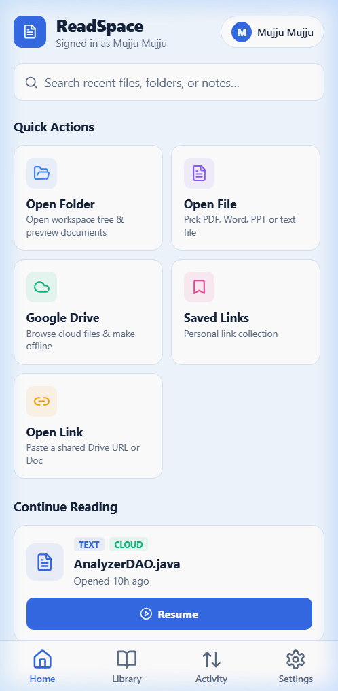

- **UI Component Breakdown:**
  - **Top Header:** Brand title and quick cloud connectivity status badge.
  - **Quick Action Grid:** Touch-friendly buttons for **Open File**, **Open Folder**, **Connect Drive**, and **Paste Link**.
  - **Continue Reading Section:** One-tap card resuming the last active mobile document.
  - **Bottom Navigation Bar:** Tab icons for **Home**, **Library**, **Activity**, and **Settings**.
- **Codebase Source:** `readspace_app/src/screens/HomeScreen.tsx`.

---

### 13. Mobile On-Device Library
The local document repository organizing files and folders imported from phone storage.

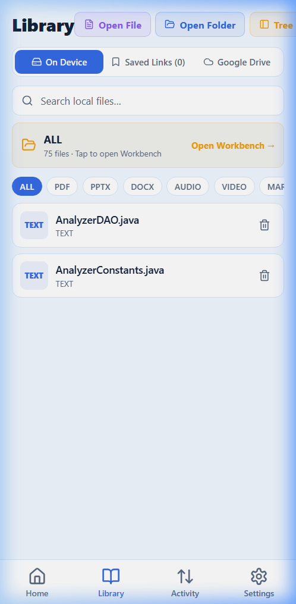

- **UI Component Breakdown:**
  - **Source Tabs:** Segmented control toggling between **On Device**, **Saved Links**, and **Google Drive**.
  - **Format Filters:** Fast filter pills for **All**, **PDF**, **Markdown**, and **Docs**.
  - **Document Cards:** File cards displaying document icons, titles, byte sizes, and last-read timestamps.
- **Codebase Source:** `readspace_app/src/screens/LibraryScreen.tsx`.

---

### 14. Mobile Google Drive Cloud Library
The cloud library view browsing remote Google Drive folders directly from a smartphone.

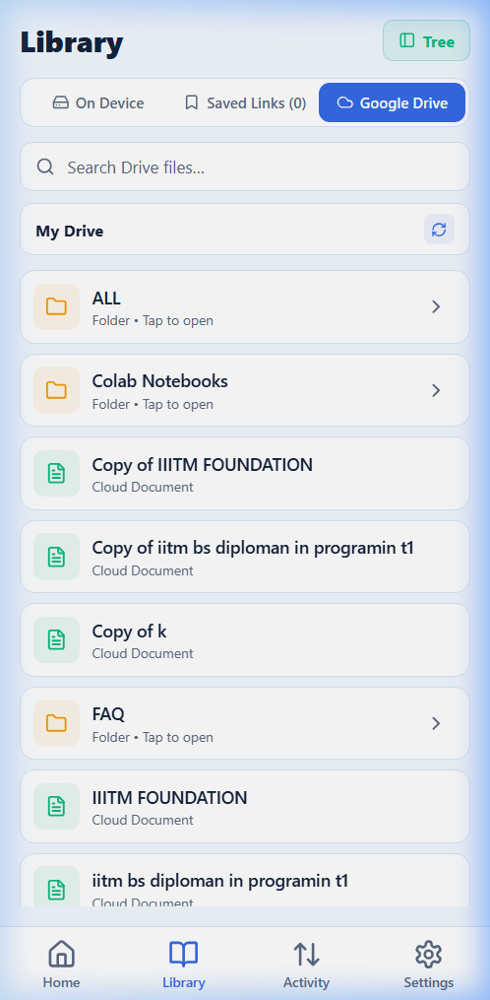

- **UI Component Breakdown:**
  - **Cloud Folder Tree:** Touch-friendly folder browsing with instant child directory expansion.
  - **Stream & Cache Triggers:** Tapping any document streams it from Google Drive and caches it for offline reading.
- **Codebase Source:** `readspace_app/src/screens/LibraryScreen.tsx`.

---

### 15. Mobile Reader in Distraction-Free Reading Mode
The touch-optimized mobile reading canvas with clean typography and minimized peripheral chrome.

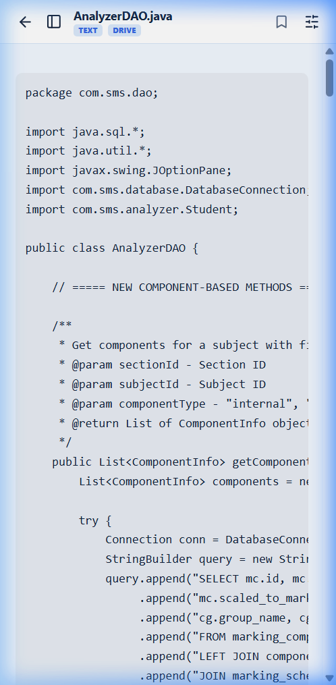

- **UI Component Breakdown:**
  - **Top Reader Bar:** Back button, document title, format badge (`MD` / `PDF`), and action triggers (Drawer Tree, Bookmark, Settings).
  - **Reading Canvas:** Touch-scrollable text viewport with comfortable margins and high-legibility typography.
  - **Zen Floating Trigger:** Optional floating button allowing one-tap entry into Zen mode.
- **Codebase Source:** `readspace_app/src/screens/ReaderScreen.tsx`, `readspace_app/src/components/HybridReader.tsx`.

---

### 16. Mobile Slide-Out Workspace Drawer
The intra-workspace directory navigation drawer sliding out from the left edge of the mobile reading canvas.

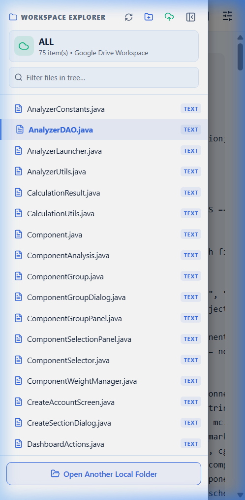

- **UI Component Breakdown:**
  - **Drawer Header:** Active workspace folder name and search filter bar.
  - **Directory Hierarchy:** Indented folder tree allowing immediate document switching with a single tap.
  - **Backdrop Dismiss:** Tapping the semi-transparent overlay immediately dismisses the drawer.
- **Codebase Source:** `readspace_app/src/components/WorkspaceDrawer.tsx`.

---

### 17. Mobile Settings & Configuration Screen
The central configuration panel managing visual themes, backend endpoints, and cache purging.

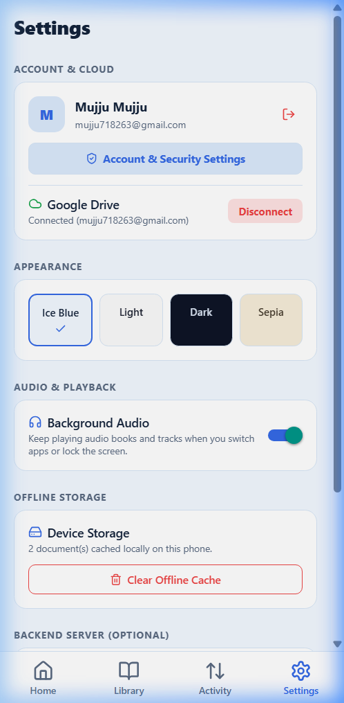

- **UI Component Breakdown:**
  - **Theme Selector:** Four color swatch buttons (**Ice Blue**, **Light**, **Dark**, **Sepia**).
  - **Audio Preferences:** Toggle for enabling background audio playback when the app is minimized.
  - **Backend Server URL:** Input field and **Test Connection** button for custom backend deployments.
  - **Storage & Cache:** Storage usage indicator and **Clear Cache** action button.
- **Codebase Source:** `readspace_app/src/screens/SettingsScreen.tsx`.

---

### 18. Mobile Automated Update Checker
The update dialog querying Expo OTA channels and GitHub Releases to ensure client currency.

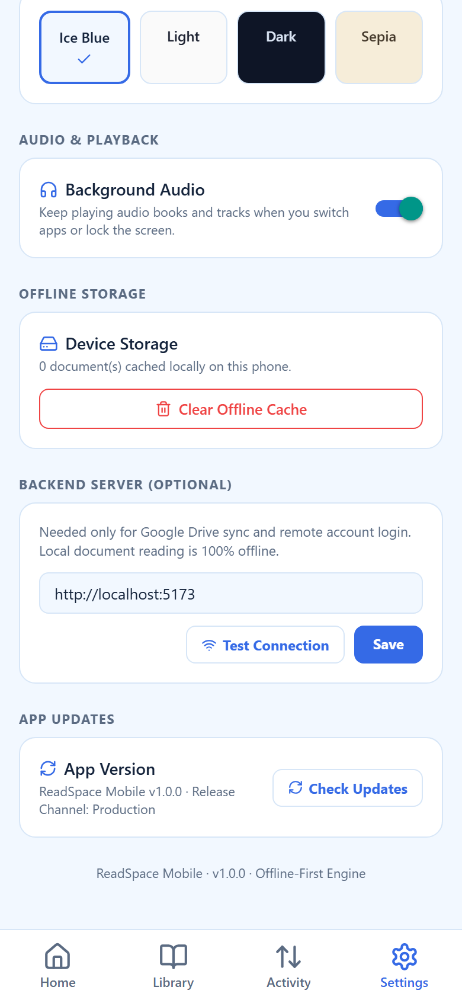

- **UI Component Breakdown:**
  - **Update Status Card:** Displays current installed version and target distribution channel.
  - **Check Updates Trigger:** Queries the update service and prompts to download new code bundles or APK packages.
- **Codebase Source:** `readspace_app/src/services/update.ts`.

---

**Codebase References:**
- Web Gallery Sources: [screenshots/](file:///d:/AVTIVE%20PROJ/readspace/screenshots/)
- Mobile Gallery Sources: [readspace_app/screenshots/](file:///d:/AVTIVE%20PROJ/readspace/readspace_app/screenshots/)
- Docs Image Directory: [docs/ReadSpace-Documentation/images/](file:///d:/AVTIVE%20PROJ/readspace/docs/ReadSpace-Documentation/images/)
