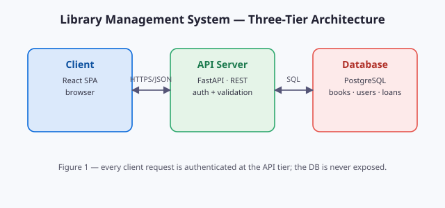

---
# Welcome to ReadSpace 📖

This is the **built-in sample workspace** — a small folder of mixed-format files
so you can try every viewer without picking a real folder.

## What to try

1. Open `notes/python-basics.md` — GitHub-flavoured Markdown with code, tables and task lists.
2. Open `papers/readspace-demo.pdf` — continuous-scroll PDF with zoom and fit-width.
3. Open `papers/sample-report.docx` — a Word file rendered to clean HTML.
4. Open `docs/project-report.html` — a sandboxed HTML preview (scripts disabled).
5. Open `notes/reading-list.txt` — plain text with a wrap toggle.
6. Toggle **Preview | Split | Edit** on any Markdown file (top-right of the content area) and press <kbd>Ctrl</kbd>+<kbd>S</kbd> to save.

## Keyboard shortcuts

| Shortcut | Action |
| --- | --- |
| `Ctrl+P` | Quick open a file |
| `Ctrl+B` | Toggle the sidebar |
| `Ctrl+W` | Close the current tab |
| `Ctrl+Tab` | Next tab |
| `Ctrl+S` | Save edits (works in real folders on Chrome/Edge) |
| `Ctrl+Alt+Z` | Zen mode — hide all chrome |

> **Tip:** drag the divider between the sidebar and the content to resize it.
> Double-click the divider to reset. Your layout, tabs and theme are remembered
> between visits.

## Using your own folder

Click **Open Folder** in the top bar. On Chrome and Edge you get full read/write
access and ReadSpace restores your last folder automatically on the next visit.
Other browsers open folders in a read-only snapshot mode.

## Diagrams & SVG

SVG images referenced from Markdown render inline:

And raw inline SVG blocks work too (diagrams pasted from draw.io / Excalidraw
included):

<svg xmlns="http://www.w3.org/2000/svg" viewBox="0 0 460 90" font-family="Segoe UI, sans-serif">
  <defs><marker id="arr" markerWidth="8" markerHeight="8" refX="6" refY="3" orient="auto"><path d="M0 0 L6 3 L0 6 z" fill="#64748b"/></marker></defs>
  <rect x="4" y="4" width="110" height="82" rx="10" fill="#dbeafe" stroke="#93c5fd"/>
  <text x="59" y="48" text-anchor="middle" font-size="13" fill="#1e40af">Browser</text>
  <path d="M118 45 h40" stroke="#64748b" stroke-width="2" marker-end="url(#arr)"/>
  <rect x="162" y="4" width="110" height="82" rx="10" fill="#dcfce7" stroke="#86efac"/>
  <text x="217" y="48" text-anchor="middle" font-size="13" fill="#166534">ReadSpace</text>
  <path d="M276 45 h40" stroke="#64748b" stroke-width="2" marker-end="url(#arr)"/>
  <rect x="320" y="4" width="110" height="82" rx="10" fill="#fef3c7" stroke="#fcd34d"/>
  <text x="375" y="48" text-anchor="middle" font-size="13" fill="#92400e">Your files</text>
</svg>

---

*ReadSpace v0.1 — built with React, pdf.js, mammoth.js, CodeMirror 6 and marked.*
